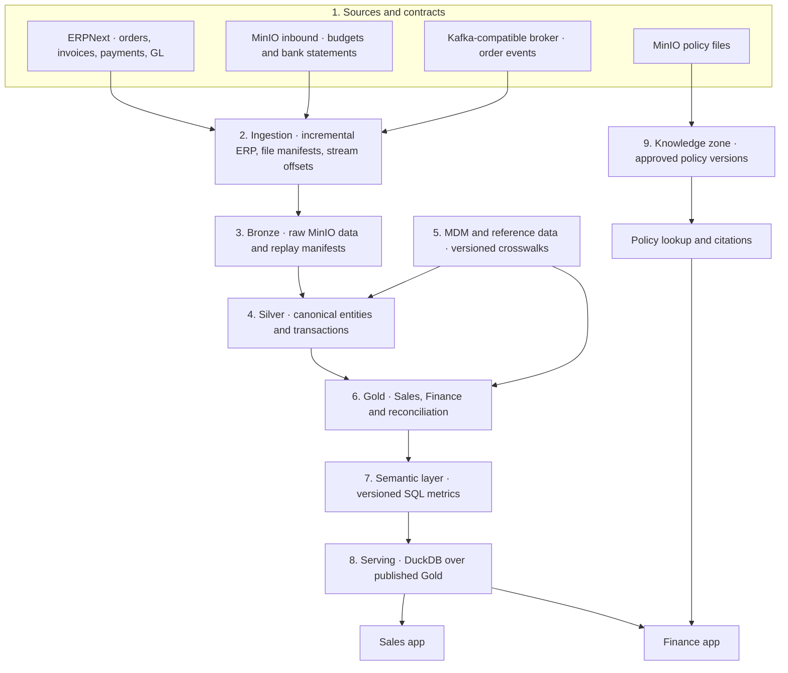
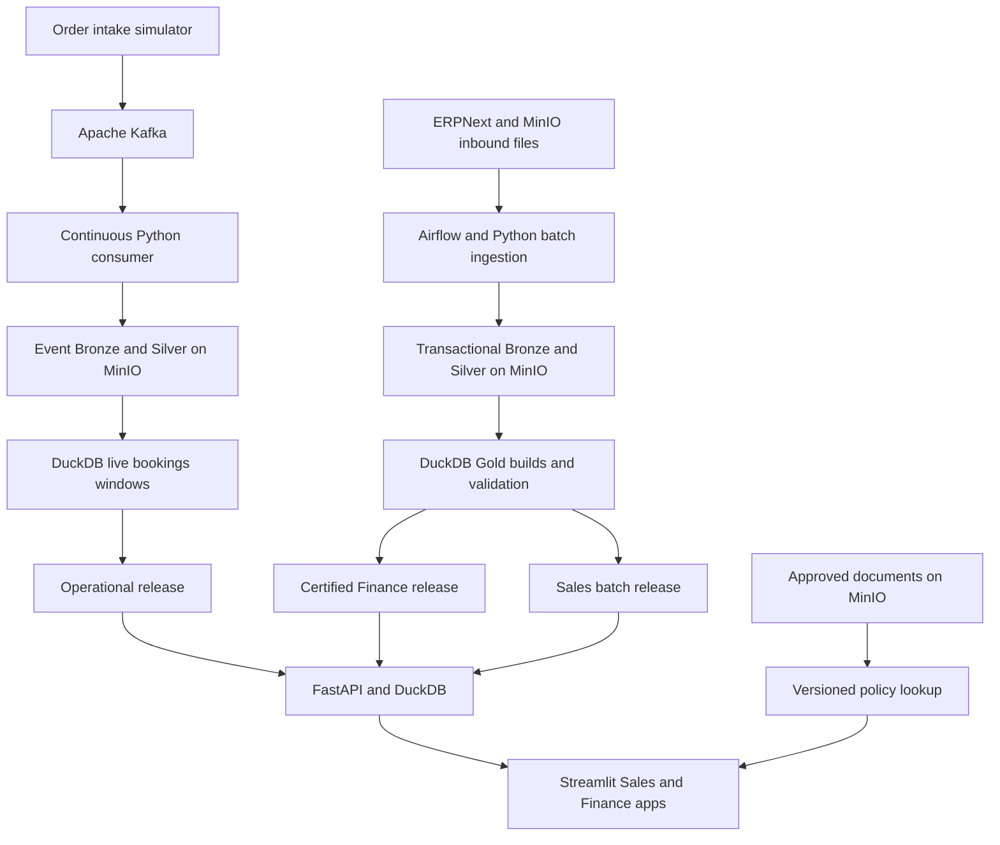
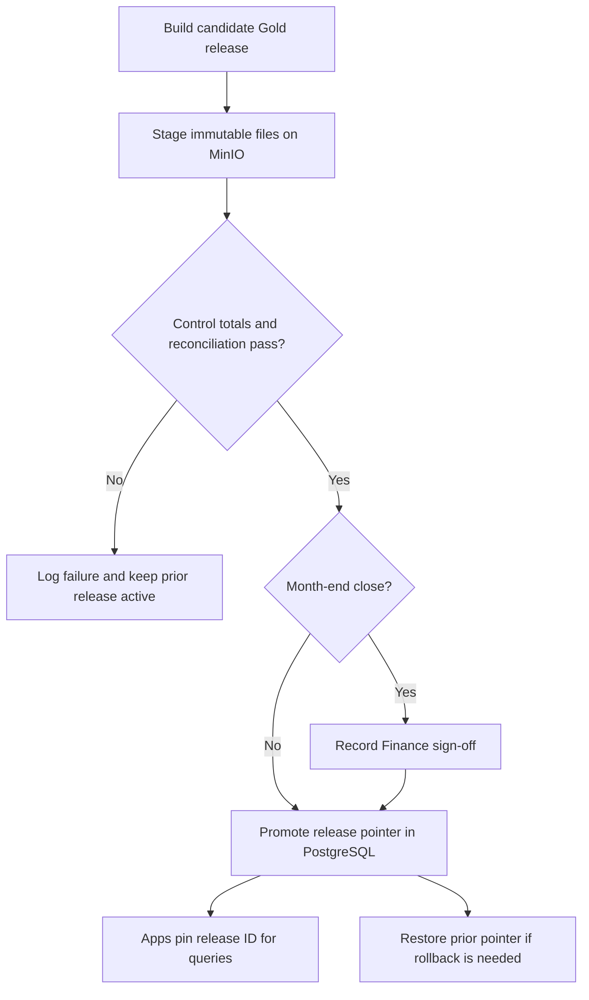

# Order-to-cash target architecture

A local enterprise data platform for a commercial equipment distributor selling through dealers, e-commerce, and direct sales. Sales monitors bookings, margin, and customer activity. Finance manages receivables and collections, compares results with budget, and certifies revenue against the general ledger (GL).

This document describes the target architecture and implementation sequence. See the [project README](../README.md) for deployment guides and the current implementation status.

## End-to-end architecture

Orchestration, quality checks, lineage, access controls, and observability span the data path. The policy path supplies explanations and citations. Certified figures come through the structured metric path.

## Architecture layers

The nine layers follow *Accordion_Round_2_Data_Architecture.html*. The first local release assumes one ERPNext company, INR, and a single deployment region. The model carries legal entity, currency, source-system, and fiscal-period keys so a second ERP can be introduced later.

| Layer | Local design | Verification |
|---|---|---|
| **1. Sources and contracts** | ERPNext supplies customers, products, orders, shipments, invoices, credit notes, payment allocations, and GL entries. MinIO inbound supplies versioned budget files and bank statements. A simulated order intake service emits accepted and cancelled events. Contracts define grain, keys, timestamps, change and delete behavior, owners, sensitivity, and expected freshness. | Check fixture payloads, schema compatibility, and financial control totals. Version business meaning changes, including changes to the definition of an invoice date. |
| **2. Ingestion** | Take an ERP snapshot, then paginate changes using modification time and a stable document ID with overlap and periodic reconciliation. Use file manifests and checksums for MinIO. Key stream partitions by external order ID and checkpoint offsets after durable writes. Use stable ingest identities, bounded retries, and quarantine. Evaluate log-based CDC when the source and operating model support it. | Replay after a failure between durable write and checkpoint. Confirm totals stay stable and missing or malformed inputs surface explicitly. |
| **3. Bronze** | Preserve original payloads in restricted MinIO storage with source IDs, operation, schema version, event and ingest timestamps, and offset or load ID. Store immutable load manifests and defined retention rules. | Verify checksums, reconstruct an input range from its manifest, and keep incompatible records out of Silver. |
| **4. Silver** | Build canonical order, shipment, invoice, credit, allocation, and journal-line records. Normalize timestamps, currencies, fiscal periods, and account codes. Retain reversals, cancellations and posting history. Preserve order-to-invoice line links and payment-to-invoice allocations at their native grains. Apply effective-dated dimensions and deterministic deduplication. | Check uniqueness, referential integrity, historical dimension intervals, and control totals by entity, period, and currency. Test a late posting and a reversal. |
| **5. MDM and reference data** | Version product, customer, legal entity, chart-of-accounts, and channel crosswalks. Maintain an approved fiscal calendar. Use trusted IDs first and route ambiguous mappings to a steward. Keep source keys for audit and reruns. Add approved FX rate versions when introducing multiple currencies. | Reverse a bad mapping and rebuild affected records while retaining the mapping version used by earlier releases. |
| **6. Gold data products** | Build dimensional marts over atomic order lines, invoice lines, payment allocations, and posted journal lines. Share conformed date, entity, customer, and product keys where applicable. Recompute affected periods for late or corrected records. Publish validated, versioned Gold Parquet to MinIO. | Verify aggregates against atomic facts and ledger controls before promoting a release. Keep its predecessor available for rollback. |
| **7. Semantic layer** | Version SQL definitions for bookings, invoiced sales, posted revenue, cash collected, AR, and gross margin. Finance owns revenue, fiscal period, and reversal rules. Calculate ratios from their component totals and guard against join fan-out. | Prove definitions on fixed fixtures, tie Finance metrics to the certified close snapshot, and show freshness and certification status in both apps. |
| **8. Serving** | Use DuckDB as the analytical query engine over published Parquet. Serve Sales and Finance dashboards and drill-through from authorized views. Enforce identity and entity access in the serving application and restrict direct object access. Keep rebuild jobs outside the dashboard query process. | Test access scopes, query latency, freshness, and visibility of release IDs under concurrent build and read activity. |
| **9. Knowledge zone** | Maintain approved finance policies and account mapping guidance with document ID, version, effective dates, permissions, and withdrawal status. Start with document lookup and citations. Add parsing, OCR, and indexed retrieval when policy search is in scope. | Resolve the policy version effective for the requested date and verify that withdrawn or unauthorized versions disappear from search and cached results. |

## Gold products

| Product | Output grain | Decision or measure |
|---|---|---|
| Sales `gold_sales_daily` | Business day × entity × region × product category | Bookings by order date, net invoiced sales by document date, and gross margin using traceable COGS. Order counts across categories require a fresh distinct count at the requested grain. |
| Sales `gold_customer_360` | Customer × snapshot date | Lifetime net invoiced sales, recent orders, and a 120-day inactivity flag for previously active customers. |
| Sales `gold_orders_live` | Five-minute event-time window × channel | Unique accepted orders and separate cancellation counts. Replay and late arrivals update the appropriate window. |
| Finance `gold_ar_aging` | Open invoice × as-of date | Balance as of the cutoff after posted payment and credit allocations. Buckets are current, 1–30, 31–60, 61–90, and 91+ days past due. |
| Finance `gold_collections_monthly` | Invoice due month × entity | Eligible amounts due, allocated cash collected against that cohort as of the reporting cutoff, collection rate, and average days to pay for fully settled invoices. |
| Finance `gold_pnl_vs_budget` | Fiscal month × entity × region × category × budget version | Posted GL revenue, COGS, and gross margin against approved budget. Surface unmapped GL lines and budget coverage gaps. |
| Shared `gold_revenue_reconciliation` | Invoice or credit note × entity × as-of date | Compare net invoiced amounts with linked GL revenue postings. Show matched, timing difference, and unexplained exception statuses, with drill-through to source documents. Surface unlinked revenue postings in the exception view. |

## Release and operating controls

- **Orchestration and recovery.** Track source checkpoints independently from the published watermark. Stage backfills in an isolated release, validate control totals, and promote via a single release pointer. Keep the previous certified release available for rollback and exercise recovery from a verified checkpoint.
- **Quality and certification.** Sales owns bookings and customer activity. Finance signs off on the revenue rules, reconciliation thresholds, and month-end snapshot. A failed critical check blocks promotion and leaves the last certified release visible with its freshness timestamp. Late close adjustments follow an approved restatement workflow.
- **Security and lineage.** Assign separate identities for ingestion, transformation, and serving. Track dashboard metric version → Gold release → Silver transform and crosswalk versions → Bronze load → source document, event offset, or file checksum. Apply access and retention rules to raw data, logs, and backups.
- **Observability and capacity.** Measure source lag, backlog, quarantine volume, reconciliation breaks, publish freshness, and query latency. Benchmark month-end rebuilds alongside dashboard reads. Treat 15-minute bookings visibility, a reconciled daily release by 07:00 local business time, and a signed month-end snapshot as proposed targets from the reference scenario.

## Repository structure

Use a monorepo with separately runnable ingestion, transformation, and serving components. Keep source contracts, deployable code, and operating procedures under version control. The paths below describe the target layout.

| Path | Responsibility |
|---|---|
| `contracts/sources/{erpnext,minio,orders}/` | Source schemas, keys, change semantics, ownership, and compatibility rules. Contracts describe the interface. Connectors implement it. |
| `contracts/products/{sales,finance,shared}/` | Published schemas, grain, freshness targets, owners, and compatibility requirements for each Gold product. |
| `pipelines/ingestion/{erpnext,minio_files,order_events}/` | Source-specific extraction, file intake, and stream consumption. |
| `pipelines/bronze/` | Raw writes, load manifests, quarantine routing, and replay boundaries. |
| `transforms/silver/` | Canonical entities and transactions, historical dimensions, deduplication, and validation. |
| `reference/{schemas,seed}/` | Contracts and synthetic seed inputs for the fiscal calendar and ERP crosswalks. Publish runtime mapping versions as governed datasets. |
| `transforms/gold/{sales,finance,shared}/` | Business output models organized by ownership. Invoice-to-GL reconciliation belongs in `shared/` with Finance as certifier. |
| `semantic/{sales,finance,shared}/` | Versioned metric definitions and authorized SQL views. |
| `serving/duckdb/` and `apps/{sales,finance}/` | DuckDB release resolution and query configuration in serving. Dashboard routes, scoped access and presentation in the apps. |
| `knowledge/` | Policy metadata, access and version handling, and citation lookup when this component is introduced. |
| `orchestration/` | Schedules, dependencies, backfill entry points, and Gold promotion and rollback workflows. |
| `config/environments/` and `infra/compose/` | Non-secret environment settings and local service deployment for ERPNext, MinIO, the broker, and application processes. |
| `observability/` and `docs/runbooks/` | Dashboards, alerts, and procedures for stale data, failed reconciliation, replay, restore, and close restatement. Keep contracts and architecture decisions linked from `docs/`. |
| `seed/` and `tests/{fixtures,unit,contract,integration,e2e}/` | Deterministic source seeders and independently calculated expectations. Cover contract compatibility, real service integration, and source-to-dashboard outcomes. |
| `.github/workflows/` | CI checks for code, schema compatibility and model tests, plus an end-to-end smoke run on the local stack. This path assumes GitHub Actions. |

Keep source payloads, MinIO objects, broker data, checkpoints, DuckDB runtime files, credentials, and generated extracts outside version control. Persist local service state in volumes. Give development and integration tests distinct bucket names, broker topics, and state stores so replay and cleanup are isolated.

**Start with the dealer-order slice.** Create directories as the slice needs them. First commit the source and output contracts, deterministic fixture, and expected order, AR, and GL results. Then add the Compose stack and connectors, one path from Bronze through Gold, and a DuckDB smoke test. Use that path to verify recovery by rerunning ingestion after a simulated failure and checking that both apps still read the last certified release until a new one passes validation.

## Implementation sequence

1. **Define contracts and the first fixture.** Follow one dealer order through two shipments, two invoices, a partial payment, and a credit note. Record the exact expected Sales, AR, and GL results at fixed cutoffs.
2. **Bring up the local stack and seed the sources.** Use ERPNext for transactional records, MinIO for inbound files and lake storage, and a Kafka-compatible broker for order events. Make seeds deterministic and rerunnable. Scale toward 12 months, 300 customers, 150 products, and 10,000 orders after the fixture passes.
3. **Run ingestion and build Bronze and Silver.** Prove ERP incremental loads, file idempotency, event replay, and effective-dated mappings. Seed duplicate and late events, unmatched bank items, and around 1% reconciliation test cases spanning timing differences and deliberate breaks.
4. **Publish Gold and connect both apps.** Start with Sales daily, live bookings, AR aging, and revenue reconciliation from the fixture. Validate through DuckDB, then add Customer 360, collections, and budget variance.
5. **Exercise production operations locally.** Test interrupted runs, backfills, rollback, close restatement, access controls, and recovery. Add policy citations through the knowledge zone when those workflows are introduced.

The first slice passes when a replayed acceptance event counts once, the lines from both invoices and the credit appear in net invoiced sales, the partial payment and credit produce the expected open AR at each cutoff, and the net invoice and credit totals reconcile to the GL.

## Architecture decisions and local open-source stack

The local design applies the nine layers in *Data_Architecture.html* to a single ERPNext company, one region, and INR. It has three operating paths: live Sales bookings, certified Finance reporting, and approved policy lookup. Sales uses five-minute event-time windows with a proposed 15-minute freshness target. Finance targets a reconciled daily release by 07:00 local business time and a signed month-end snapshot.

### Runtime paths

### Architectural concerns

| Concern | Decision and verification |
|---|---|
| **Financial authority and grain** | ERPNext is authoritative for transactions and GL. Sales owns bookings and net invoiced sales definitions. Finance certifies posted revenue, COGS, AR, and close results. Retain source line IDs and distinguish order, invoice, posting, allocation, and ingest timestamps. Verify totals at the appropriate date and grain using fixed-precision arithmetic. |
| **Replay and late data** | Deduplicate using durable source identities. Advance checkpoints only after a durable write and make reprocessing idempotent. Preserve cancellations, credits, and reversals. Test duplicate and late events and rebuild only affected windows or periods. |
| **Publication and close** | Stage complete, immutable Parquet releases and promote separate pointers for live Sales, batch Sales, and Finance in PostgreSQL. Pin the release for each query. Leave the prior Finance release available when a gate fails. Version signed close snapshots and restatements. |
| **Quality and lineage** | Validate keys, source counts and amounts, and invoice-to-GL controls before promotion. Expose genuine business discrepancies with reasons. Trace a metric through the Gold release, Silver rules and mappings, Bronze load, and source record. |
| **Access and residency** | Isolate pipeline and serving identities. Apply entity and product entitlements at the API boundary. Restrict raw and policy storage independently. Exercise entity-level access with test fixtures. Extend regional storage, backup, and export controls when a second region is introduced. |
| **Capacity and recovery** | Isolate build processes from dashboard queries. Measure backlog, source lag, publish freshness, query latency, and close workload contention. Drill restart, replay, rollback and restore. Use measured recovery to agree RPO and RTO. |

### Local deployment by layer

| Layer | Open-source components | Role |
|---|---|---|
| **1. Sources and contracts** | ERPNext, MinIO, Apache Kafka, JSON Schema | ERP transactions, approved budget and bank files, and synthetic accepted or cancelled order events. Version source contracts. |
| **2. Ingestion** | Python, HTTPX, boto3, Kafka client, PostgreSQL | Snapshot and incremental ERP extraction, manifest-based file ingestion, and continuous stream consumption. Store batch checkpoints and run metadata in PostgreSQL. |
| **3. Bronze** | MinIO | Preserve raw payloads, replay manifests, and quarantined inputs in access-controlled storage. |
| **4. Silver** | DuckDB, Python, Apache Parquet, MinIO | Standardize transactions, resolve effective-dated mappings, reconcile source totals, and publish versioned canonical records. |
| **5. MDM and reference data** | PostgreSQL, Python, MinIO | Govern fiscal calendars and versioned product, customer, legal entity, and chart-of-accounts crosswalks. Route ambiguous mappings to steward review. |
| **6. Gold data products** | DuckDB SQL, Apache Parquet, MinIO, PostgreSQL | Build Sales, Finance, and shared products. Store output by release ID and maintain active pointers and Finance certification metadata. |
| **7. Semantic layer** | Versioned SQL and DuckDB views | Define metrics at their approved grains. Test aggregations and make freshness and certification visible to consumers. |
| **8. Serving** | FastAPI, DuckDB, Streamlit, Keycloak | Query approved releases and expose dashboard and drill-through endpoints. Introduce Keycloak for identity and role tests. |
| **9. Knowledge zone** | MinIO, PostgreSQL, Apache Tika | Govern policy versions, effective dates, access, withdrawal, and citations. Introduce Tika for text extraction when policy search is implemented. |

Use Docker Compose for local services, Apache Airflow for scheduled workflows and backfills, pytest and SQL assertions for validation, and Prometheus and Grafana for operating metrics. Run Kafka consumption as a continuous service. The first release uses DuckDB and versioned Parquet with one controlled publisher per product. Evaluate Apache Iceberg if concurrent table writers, frequent row-level changes, or multiple processing engines become requirements.

### Finance release workflow

The first implementation milestone uses one dealer order, two invoices, a partial payment, and a credit note. Acceptance requires one live booking after event replay, the expected AR balance at two cutoffs, and an invoice-to-GL tie-out. Repeat the fixture after an interrupted run to verify recovery and release consistency.
