# Gold dimensional design

Order-to-cash facts for the parent and dealer. Each business process has a declared grain, dimension roles, measures, a circular star view, and an ERD for the same model.

## Kimball’s four design steps

1. **Select the business process.** Choose the event or measurement the business wants to analyze.
2. **Declare the grain.** Write what one fact row represents and identify its repeatable business key.
3. **Identify the dimensions.** Choose the descriptive context that applies at that grain.
4. **Identify the facts.** Choose measures at that grain and specify how they can be aggregated.

Diagram notation PK marks a proposed technical primary key. Each grain declaration supplies the business uniqueness rule to enforce. FK marks a dimension key. Multiple date roles reuse the same Date dimension. Order, invoice, payment, voucher and event identifiers remain available for traceability and scoped counts.

Legal Entity, Date and Currency are reused where applicable. Customer and Product use approved Silver mappings. Unknown members preserve facts with incomplete dimensional coverage. Source IDs, allocation timing, business cutoffs and mapping versions remain traceable.

The diagrams show a logical proposal. Booking eligibility, settlement dates, and calendar, scope and channel conventions require confirmation against the selected Silver release. [Kimball Group’s four-step design process](https://www.kimballgroup.com/data-warehouse-business-intelligence-resources/kimball-techniques/dimensional-modeling-techniques/four-4-step-design-process/)

## Silver-to-Gold transformation contract

Build Gold from one published Silver release. The notebook publisher writes Delta tables to MinIO, then commits a `manifest.json` with the model run ID, source selection, rule settings, and each table’s path, pinned version, row count, and checksum. The mappings below also apply to previously published JSONL releases.

- **Reuse Silver identities.** Use approved group IDs and effective-dated crosswalks. Gold dimensions provide stable reporting keys and attributes. Keep scoped source IDs for drill-through. Publish descriptive attributes only when the applicable master-data rule supports them.
- **Protect fact grain.** Each input joins to at most one applicable lookup row per role and effective date. Resolve missing descriptive dimensions to an Unknown member. Surface ambiguous mappings or missing required transaction links as exceptions.
- **Publish after validation.** Record the Silver release ID, mapping and metric rules, cutoff where relevant, and validation totals. Reconcile facts before rolling them up into products.

## 1. Sales order booking

**Transaction fact** · `fact_sales_order_booking`

| Kimball step | Design |
| --- | --- |
| 1. Business process | What did customers book by business date, customer, product and selling company? |
| 2. Grain and row key | One qualifying booked sales order line recorded by a source system for a selling legal entity, with its booking date, customer and product. Row key is Source system + stable legal entity ID + source order ID + source order line ID. |
| 3. Dimensions | Booking date (dim_date), Customer (dim_customer), Product (dim_product), Legal entity (dim_legal_entity), Currency (dim_currency). |
| 4. Facts and aggregation | Recorded line amount and quantity, an approved comparable booking quantity where available, and one line count per fact row. Count distinct scoped order IDs for order count. Sum quantities within comparable units and amounts within one currency. |

### Star schema

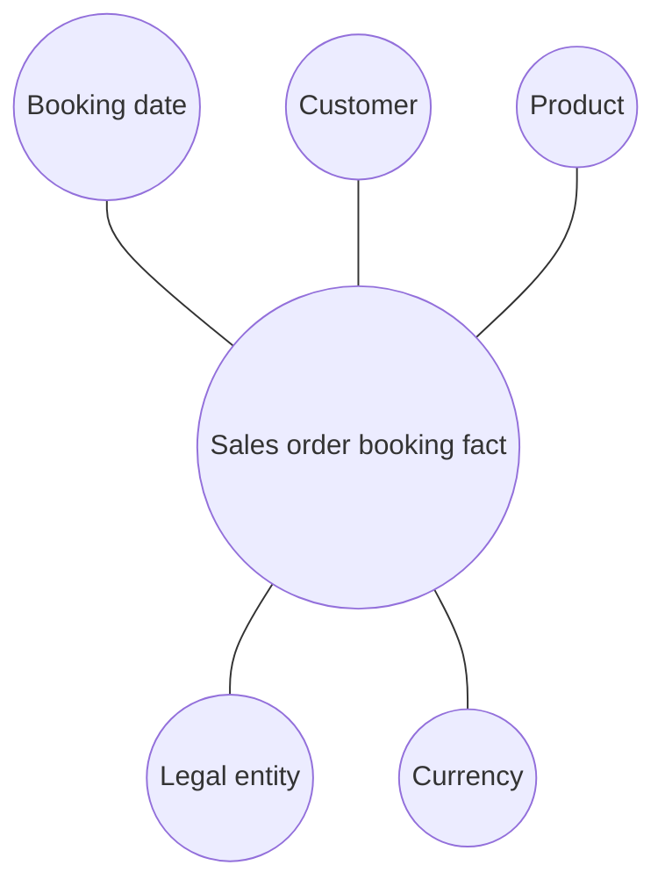

### Entity relationship diagram

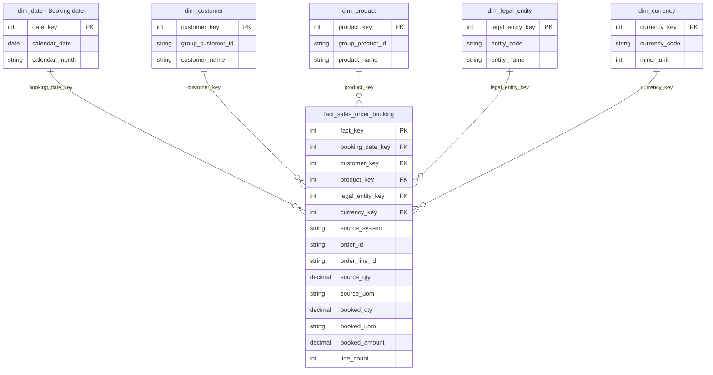

Each dimension row can relate to zero or many fact rows. Each fact foreign key resolves to one dimension row, including an Unknown member where applicable. Field types are illustrative.

- **Silver inputs.** sales_order + sales_order_line; approved order_line_conformed mappings.
- **Design rules.** Agree which source statuses qualify as booked. Preserve the order and line IDs for drill-through. Apply an Unknown member when a dimension cannot be resolved and retain the source values for audit.
- **Fixture check.** P-S1 and D-S1 yield two rows. Metro / Pump totals 11 each and ₹140,000, split ₹100,000 parent and ₹40,000 dealer.

### Silver-to-Gold worked example · Sales order booking

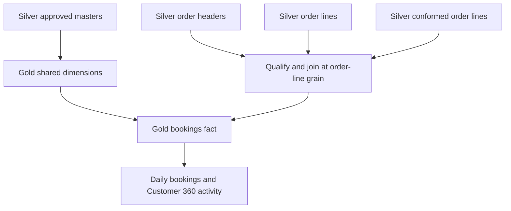

| Silver input and join | Transformation | Gold target |
| --- | --- | --- |
| Start at `sales_order_line.id` and join `sales_order_line.sales_order_id = sales_order.id`. | Apply the source-specific booking eligibility rule on the header. Use the agreed order date as the first-slice booking date. Keep the scoped header and line identities and the order reference for drill-through. | One `fact_sales_order_booking` row per qualifying line. Resolve booking date, legal entity and currency keys from the header. |
| Join `order_line_conformed.id = sales_order_line.id`. | Use the published `group_customer_id`, `group_product_id`, `conformed_quantity` and `conformed_uom`. Preserve source quantity and unit from the line and its recorded `amount` in transaction currency. | Customer and Product dimension lookups, source quantity and unit, comparable booked quantity and unit, and booked amount. |
| Look up `group_customer.id`, `group_product.id` and `legal_entity.id`. | Reuse the existing Gold dimension keys for those business identities. Use approved master attributes where available and assign Unknown keys where unresolved. | Shared Gold Customer, Product and Legal Entity dimensions. Unmapped lines still contribute booked amount. |

For the two baseline orders, this mapping produces the following expected rows. The group IDs illustrate the lookups before resolving the Gold surrogate keys.

| Source order reference | Legal entity | Booking date | Group customer | Group product | Comparable quantity | Booked amount |
| --- | --- | --- | --- | --- | ---: | ---: |
| P-S1 | Parent | 2026-11-02 | G-CUST-001 | G-PROD-001 | 10 each | ₹100,000 |
| D-S1 | Dealer | 2026-11-05 | G-CUST-001 | G-PROD-001 | 1 each | ₹40,000 |

**Product and acceptance.** Feed the bookings measures in `gold_sales_daily` and the activity measures in `gold_customer_360`. Check two fact rows, two distinct scoped orders, 11 comparable units, and ₹140,000. Keep the dealer’s blank source status explicit. The baseline check assumes D-S1 qualifies under an agreed dealer booking rule. Region and category rollups require approved attributes.

## 2. Order fulfillment

**Transaction fact** · `fact_shipment_line`

| Kimball step | Design |
| --- | --- |
| 1. Business process | What quantity shipped, when, and from which warehouse? |
| 2. Grain and row key | One dispatched shipment line recorded by a source system for a selling legal entity, for one product and dispatch warehouse where supplied. Row key is Source system + stable legal entity ID + source shipment ID + source shipment line ID. |
| 3. Dimensions | Shipment date (dim_date), Customer (dim_customer), Product (dim_product), Legal entity (dim_legal_entity), Dispatch warehouse (dim_warehouse). |
| 4. Facts and aggregation | Shipped quantity and one shipment line count per row. Count distinct scoped shipment IDs for shipment count. Use comparable units for quantities across sources. |

### Star schema

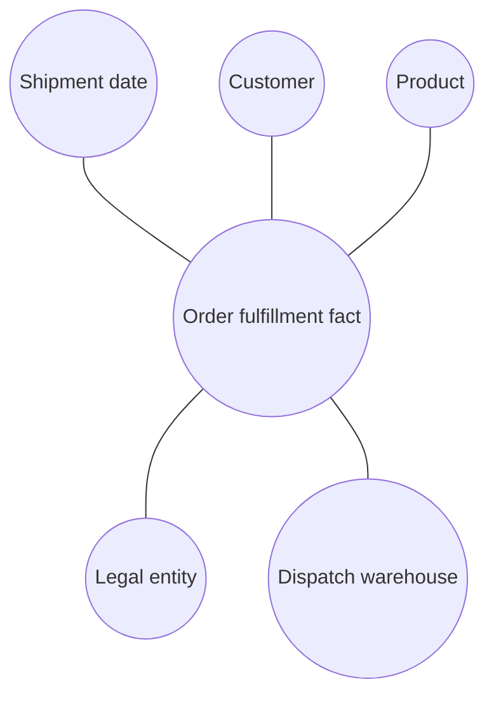

### Entity relationship diagram

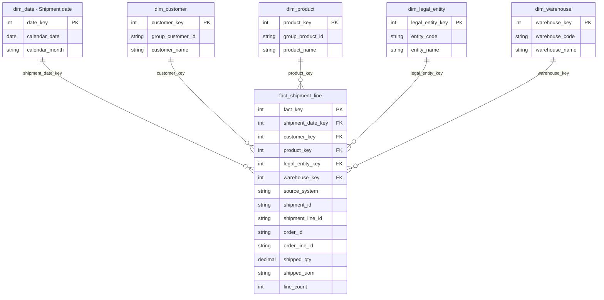

Each dimension row can relate to zero or many fact rows. Each fact foreign key resolves to one dimension row, including an Unknown member where applicable. Field types are illustrative.

- **Silver inputs.** shipment + shipment_line, with validated order and master links.
- **Design rules.** Use actual dispatch warehouse. Dealer shipment dates are absent from the observed feed, so use Unknown date and preserve shipment quantity. The customer role can resolve through the order when supported. Physical returns retain separate lineage in Silver.
- **Fixture check.** Parent P-S1 has two shipment rows, six and four units from different warehouses. Dealer D-S1 has one shipment row for one unit.

### Silver-to-Gold mapping · Order fulfillment

| Silver input and join | Transformation | Gold target |
| --- | --- | --- |
| `shipment_line.document_id = shipment.id` | Use the qualifying dispatch header, its posting date and the line’s recorded quantity and unit. Apply an explicit source rule where dealer document status is unavailable. | `fact_shipment_line`, shipment date, entity and shipped quantity. |
| `shipment_line.sales_order_line_id = sales_order_line.id`, then join the linked `sales_order`. Use `shipment.sales_order_id` for customer context when a verified header link exists. | Resolve customer by the approved crosswalk and product through the shipment line’s `source_product_id` and the approved crosswalk. Take the warehouse directly from `shipment_line.warehouse_id`. Leave unresolved order-line linkage visible. | Customer, Product and dispatch Warehouse keys, plus order drill-through. |

**Use and acceptance.** Supports fulfillment and traceability into billing or COGS when a verified downstream link exists. P-S1 must retain two dispatch lines, six and four units. D-S1 retains one line and an Unknown shipment date because the date is absent.

## 3. Billing and crediting

**Transaction fact** · `fact_billing_document`

| Kimball step | Design |
| --- | --- |
| 1. Business process | What did we invoice or credit by customer, legal entity and document date? |
| 2. Grain and row key | One posted invoice or credit note issued by a source system for a legal entity, at document grain. Row key is Source system + stable legal entity ID + source document type + source document ID. |
| 3. Dimensions | Document date (dim_date), Invoice due date (dim_date), Customer (dim_customer), Legal entity (dim_legal_entity), Currency (dim_currency), Document type (dim_document_type). |
| 4. Facts and aggregation | Signed billed amount and one document count per row. Invoice amounts are positive, and credits reduce net billing. Sum within currency. An invoice count filters to invoice documents. |

### Star schema

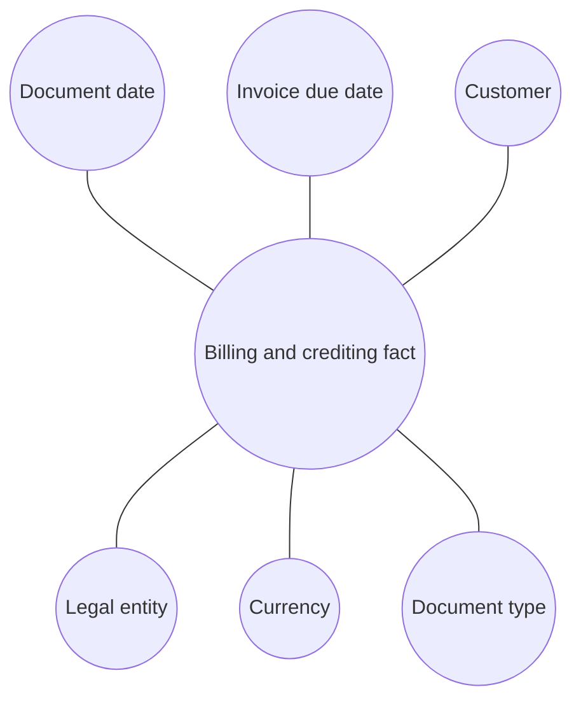

### Entity relationship diagram

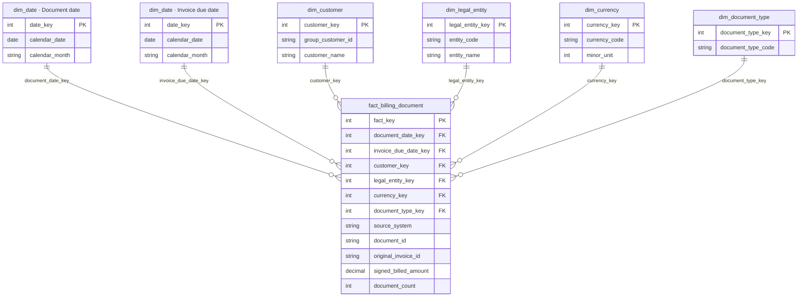

Each dimension row can relate to zero or many fact rows. Each fact foreign key resolves to one dimension row, including an Unknown member where applicable. Field types are illustrative.

- **Silver inputs.** billing_document, with source-customer crosswalk and document linkage.
- **Design rules.** Preserve original invoice references where present. Parent billing-line detail can support a separate line fact. The shared billing star uses document amounts from both entities, and dealer product-level attribution remains uncovered.
- **Fixture check.** The named baseline totals ₹135,000. Parent invoices of ₹60,000 and ₹40,000 less a ₹5,000 credit give ₹95,000. Dealer D-I1 contributes ₹40,000.

### Silver-to-Gold mapping · Billing and crediting

| Silver input and join | Transformation | Gold target |
| --- | --- | --- |
| `billing_document` with its scoped `id` | Take posted invoices and credits through the release cutoff. Carry `signed_total`, `document_type`, `posting_date`, `due_date`, `currency` and `original_invoice_id` when known. | One `fact_billing_document` row per posted document, with separate document and due-date roles. |
| `billing_document.source_customer_id = customer_crosswalk.source_id` with one approved mapping effective on the approved lookup date. | Resolve the shared customer. Use `billing_document_line` for a separate, traceable product-level calculation where line coverage exists. | Shared Customer key and documented product coverage. |

**Use and acceptance.** Feeds Sales Daily, Customer 360, the collections due cohort and revenue reconciliation. The named baseline totals ₹135,000 after credits. Dealer document totals stay available for entity and customer totals where keys resolve. Product attribution remains uncovered for its document-only feed.

## 4. Cash application

**Transaction fact** · `fact_payment_allocation`

| Kimball step | Design |
| --- | --- |
| 1. Business process | How much cash was applied to which invoices, and against which due-month cohort? |
| 2. Grain and row key | One source payment allocation to one invoice for a legal entity. Multiple allocations between the same payment and invoice retain separate identities when supplied. Row key is Source system + stable legal entity ID + source payment ID + source allocation ID. |
| 3. Dimensions | Payment date (dim_date), Application date (dim_date), Invoice due date (dim_date), Customer (dim_customer), Legal entity (dim_legal_entity), Currency (dim_currency). |
| 4. Facts and aggregation | Allocated cash and one allocation count per row. Sum allocations through the reporting cutoff against the eligible invoice due cohort. Compute collection rate from total allocated cash divided by eligible amounts due. |

### Star schema

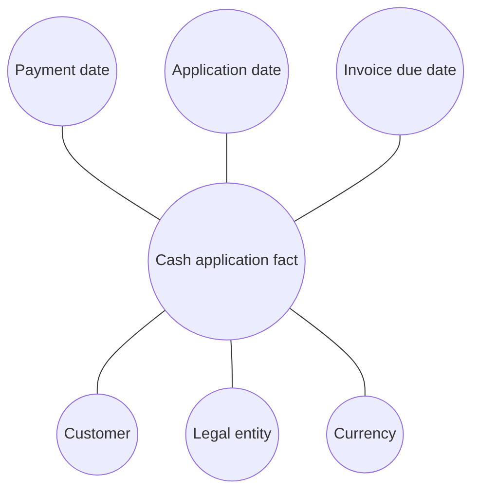

### Entity relationship diagram

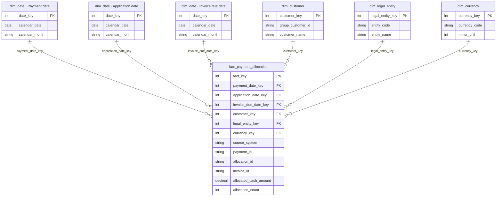

Each dimension row can relate to zero or many fact rows. Each fact foreign key resolves to one dimension row, including an Unknown member where applicable. Field types are illustrative.

- **Silver inputs.** payment_allocation + payment + billing_document.
- **Design rules.** Carry an application date only when present. A date-based collection cutoff needs documented allocation timing or a Finance-approved proxy. Derive days to pay once per fully settled invoice using the approved start and settlement dates.
- **Fixture check.** Parent P-P1 contributes ₹25,000 to P-I1. Dealer D-R1 contributes ₹10,000 to D-I1 through D-A1.

### Silver-to-Gold mapping · Cash application

| Silver input and join | Transformation | Gold target |
| --- | --- | --- |
| `payment_allocation.payment_id = payment.id` | Retain `allocated_amount` per valid allocation of a posted receipt, along with its payment date and allocation ID. Keep unsupported or unlinked allocations in exceptions. | `fact_payment_allocation`, one row per application, with Payment Date and scoped payment ID. |
| `payment_allocation.billing_document_id = billing_document.id` | Get the invoice due date, invoice and customer identity, and verify currency compatibility. Use an actual application date where sourced or an approved proxy with basis recorded. | Invoice Due Date and Customer keys, allocation amount and cutoff coverage. |

**Use and acceptance.** Feeds `gold_collections_monthly`. Aggregate allocations per invoice before comparing them with the invoice amount due. Check ₹25,000 applied to P-I1 and ₹10,000 to D-I1. The current allocation rows do not supply an independent application timestamp. Cutoff and settlement-day reporting require an approved timing rule.

## 5. Open receivables at cutoff

**Snapshot fact** · `fact_ar_snapshot`

| Kimball step | Design |
| --- | --- |
| 1. Business process | How much was open per invoice on the reporting date, and how old was that balance? |
| 2. Grain and row key | One open invoice in a source and legal entity at one reporting cutoff, using one selected balance per invoice and cutoff. Row key is Source system + stable legal entity ID + source invoice ID + as-of date. |
| 3. Dimensions | As-of date (dim_date), Invoice date (dim_date), Invoice due date (dim_date), Customer (dim_customer), Legal entity (dim_legal_entity), Currency (dim_currency), Aging bucket (dim_aging_bucket). |
| 4. Facts and aggregation | Open amount and days past due. Sum balances across invoices at the same cutoff and currency. Group into Current, 1–30, 31–60, 61–90, and 91+ days. Use Unknown bucket when the due date is missing. |

### Star schema

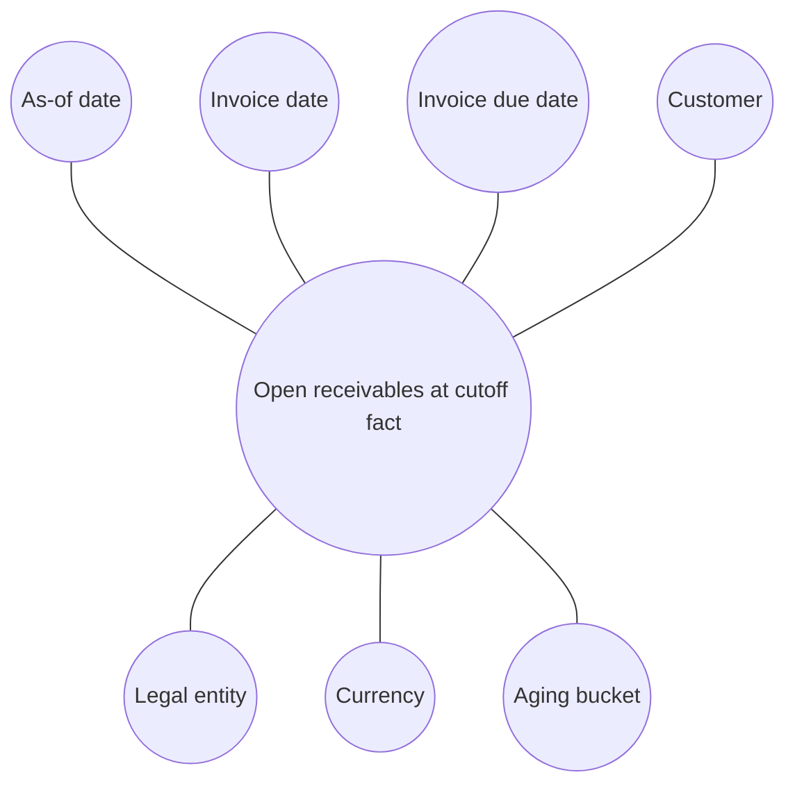

### Entity relationship diagram

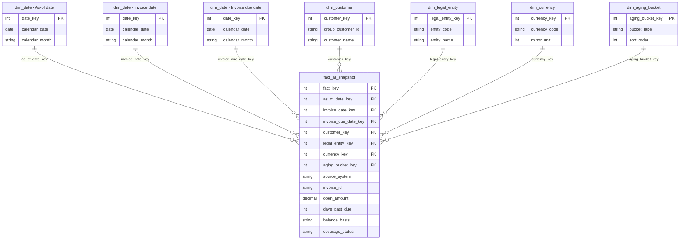

Each dimension row can relate to zero or many fact rows. Each fact foreign key resolves to one dimension row, including an Unknown member where applicable. Field types are illustrative.

- **Silver inputs.** receivables_snapshot + cutoff calculation from invoices, credits and dated cash allocations.
- **Design rules.** Show balance basis and reconciliation coverage. Select one reportable balance per invoice and cutoff and keep competing observations available for audit. A source-reported balance may be available while independent validation remains uncovered.
- **Fixture check.** At 10 Dec the named baseline has ₹100,000 open. At its 16 Dec cutoff the dealer round-two export reports ₹10,000. Its original credit linkage is missing, so independent invoice-level calculation is uncovered.

### Silver-to-Gold mapping · Open receivables at cutoff

| Silver input and join | Transformation | Gold target |
| --- | --- | --- |
| `calculated_ar_balance` and `receivables_snapshot` matched on scoped `billing_document_id`, `cutoff`, and currency. | Choose one reportable balance per invoice and cutoff under the approved precedence rule. Keep computed and exported evidence distinguishable and expose unavailable independent reconciliation. | `fact_ar_snapshot` with open amount, balance basis and coverage status. |
| `billing_document_id = billing_document.id` | Resolve invoice and due date, customer and legal entity. Derive days past due from the cutoff and due date, using Unknown aging where the due date is absent. | As-of, Invoice Date, Due Date, Customer, Entity and Aging Bucket keys. |

**Use and acceptance.** Feeds `gold_ar_aging`. The named 10 December baseline is ₹100,000. The dealer 16 December round-two export reports ₹10,000. Keep that balance at its own cutoff and flag independent invoice-level validation as uncovered because the original credit link is missing. Sum balances only within a single cutoff.

## 6. General ledger posting

**Transaction fact** · `fact_gl_posting`

| Kimball step | Design |
| --- | --- |
| 1. Business process | What did Finance post by company, account category and posting period? |
| 2. Grain and row key | One posted, in-scope general ledger entry line for one legal entity and local GL account, associated with its posting date and company currency. Row key is Source system + stable legal entity ID + source posting entry ID. |
| 3. Dimensions | Posting date (dim_date), Legal entity (dim_legal_entity), Local GL account (dim_gl_account), Reporting category (dim_reporting_account_category), Currency (dim_currency). |
| 4. Facts and aggregation | Debit, credit and posting line count. Revenue is credit less debit on mapped revenue accounts. COGS is debit less credit on mapped COGS accounts. Aggregate linked postings by billing document before comparing to billing. |

### Star schema

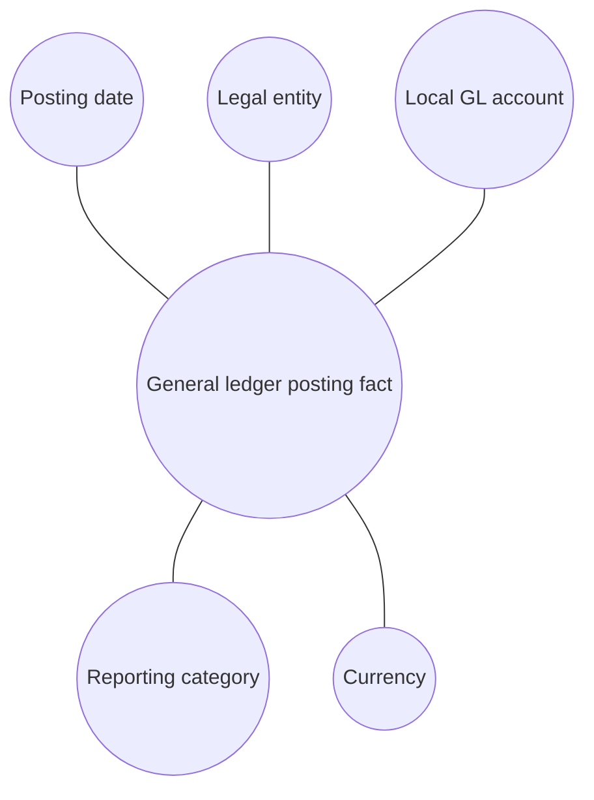

### Entity relationship diagram

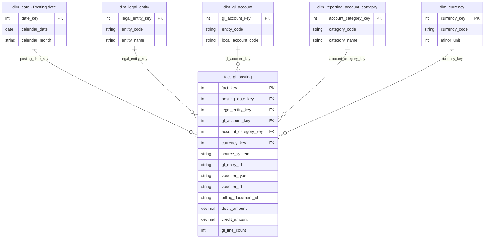

Each dimension row can relate to zero or many fact rows. Each fact foreign key resolves to one dimension row, including an Unknown member where applicable. Field types are illustrative.

- **Silver inputs.** gl_posting_line + gl_account + effective account_crosswalk.
- **Design rules.** Apply the approved posting and cancellation rules. Keep accounting reversals in their correct period. Retain unmapped categories and unlinked revenue postings for Finance review.
- **Fixture check.** The baseline billing documents reconcile to ₹135,000 in linked net GL revenue, with a ₹0 difference.

### Silver-to-Gold mapping · General ledger posting

| Silver input and join | Transformation | Gold target |
| --- | --- | --- |
| `gl_posting_line.gl_account_id = gl_account.id` | Use qualifying, non-cancelled postings through the cutoff and preserve valid reversals. Keep source entry ID, voucher ID and type, and scoped `billing_document_id` when linked. | `fact_gl_posting` with date, account, entity, currency, debit and credit. |
| `gl_posting_line.gl_account_id = account_crosswalk.source_id` effective on the posting date. | Resolve `account_crosswalk.group_id` to the reporting category. Preserve unmapped postings and derive revenue or COGS using the category’s sign convention. | Reporting Account Category key and input to posted revenue and cost measures. |

**Use and acceptance.** Feeds `gold_pnl_vs_budget`, `gold_revenue_reconciliation`, and traceable Sales Daily COGS. For reconciliation, aggregate mapped revenue postings by scoped billing document, currency and cutoff before comparing with the billing fact. The named baseline is ₹135,000 posted revenue and ₹0 difference. Show unlinked revenue separately.

## 7. Budget planning

**Planning fact** · `fact_budget`

| Kimball step | Design |
| --- | --- |
| 1. Business process | What was planned, at which approved version and reporting scope? |
| 2. Grain and row key | One budget amount per fiscal period, legal entity, scenario, version, currency and planning scope represented by its type and value. Row key is Fiscal period + stable legal entity ID + scenario + budget version + currency + scope type + scope code, with any supplied regional scope represented in the planning scope key. |
| 3. Dimensions | Fiscal period (dim_fiscal_period), Legal entity (dim_legal_entity), Scenario (dim_budget_scenario), Budget version (dim_budget_version), Currency (dim_currency), Planning scope (dim_planning_scope). |
| 4. Facts and aggregation | Planned amount at the supplied grain. Compare actuals and budget within one selected scenario, version and currency after aligning scope and fiscal period. |

### Star schema

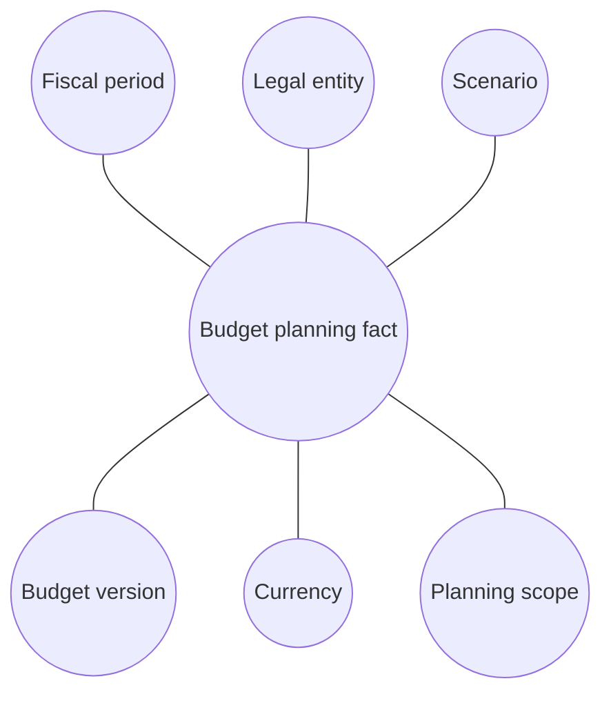

### Entity relationship diagram

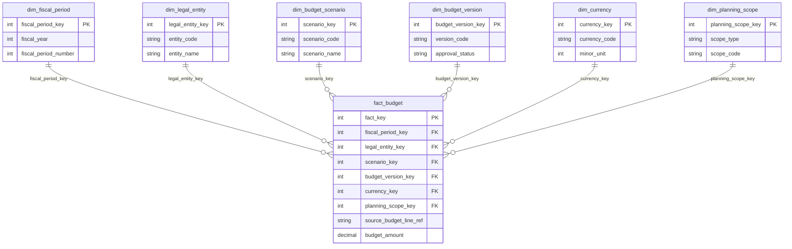

Each dimension row can relate to zero or many fact rows. Each fact foreign key resolves to one dimension row, including an Unknown member where applicable. Field types are illustrative.

- **Silver inputs.** budget_amount and its source manifest version.
- **Design rules.** Parent budget scope is product category. Dealer budget scope is local account. Resolve the fiscal period through the approved fiscal calendar and expose unavailable regional or product attribution without allocating amounts to invented slices.
- **Fixture check.** November parent PUMP plan is ₹120,000. November dealer account 400-D plan is ₹50,000 across a different planning scope.

### Silver-to-Gold mapping · Budget planning

| Silver input and join | Transformation | Gold target |
| --- | --- | --- |
| `budget_amount` with its `period`, `scenario`, `input_version`, `scope_type`, `scope`, entity and currency. | Resolve the period through the approved fiscal calendar and retain the supplied scope and input version. Use an approved scenario and version when serving comparisons. | `fact_budget` with Fiscal Period, Entity, Currency, Scenario, Budget Version and Planning Scope keys. |

**Use and acceptance.** Feeds `gold_pnl_vs_budget`. Retain the ₹120,000 parent PUMP category plan and ₹50,000 dealer account 400-D plan separately. Compare actuals only when scope, period and currency align. Report missing scope alignment as a coverage gap.

## 8. Order lifecycle events

**Transaction fact** · `fact_order_event`

| Kimball step | Design |
| --- | --- |
| 1. Business process | How many orders were accepted or cancelled by channel in each event-time window? |
| 2. Grain and row key | One logical event emitted by a source for a legal entity and order, at its source event timestamp. Row key is Source system + stable legal entity ID + source logical event ID. |
| 3. Dimensions | Event date (dim_date), Event time (dim_time), Channel (dim_channel), Event type (dim_order_event_type), Legal entity (dim_legal_entity). |
| 4. Facts and aggregation | One event count per logical event. The live product counts distinct scoped accepted orders in each five-minute event-time window and channel, and reports cancellation counts separately. |

### Star schema

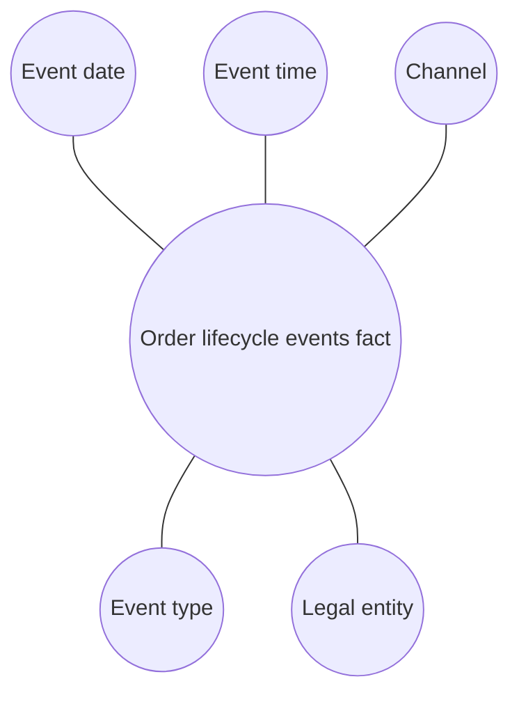

### Entity relationship diagram

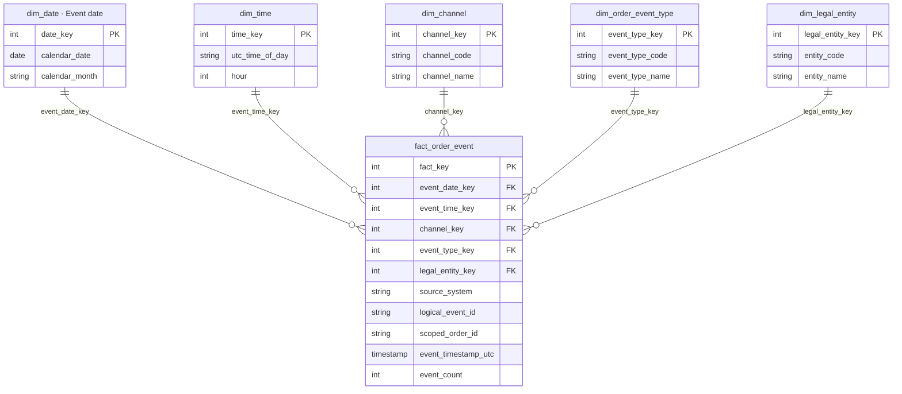

Each dimension row can relate to zero or many fact rows. Each fact foreign key resolves to one dimension row, including an Unknown member where applicable. Field types are illustrative.

- **Silver inputs.** order_event, with event_delivery retained for source lineage.
- **Design rules.** Deduplicate deliveries before counting. Retain the precise event timestamp and use the original event window for late arrivals. Resolve Channel only when supported by source data or an approved feed mapping.
- **Fixture check.** The observed inputs show four accepted logical events across parent and dealer. Two parent events were delivered at Kafka offsets 0 and 1.

### Silver-to-Gold mapping · Order lifecycle events

| Silver input and join | Transformation | Gold target |
| --- | --- | --- |
| `order_event` at logical event ID grain, with `sales_order_id` or a scoped order reference where available. | Use the original `event_time`, normalize to UTC, and retain `status_code` as the event type input. Resolve channel through an approved feed or order mapping. | `fact_order_event` with event date and time, event type, entity, channel and scoped order identity. |
| `event_delivery` and published lineage | Preserve the Kafka delivery coordinates for audit. Keep replayed deliveries out of the fact count by using the logical event identity published by Silver. | Drill-through evidence for Gold live metrics. |

**Use and acceptance.** Feeds `gold_orders_live`. Count distinct scoped accepted orders by five-minute event-time window and channel. Report cancellation counts separately and refresh the original window for late events. The observed fixture contains four logical acceptance events. Use Unknown Channel until a mapping is approved.

## Gold products and their inputs

| Product | Business processes | Output |
| --- | --- | --- |
| `gold_sales_daily` | Sales order booking, billing and GL posting | Daily bookings, net billing and margin at supported reporting scope |
| `gold_customer_360` | Sales order booking and billing | Customer activity, lifetime net billing and 120-day inactivity |
| `gold_orders_live` | Order lifecycle events | Five-minute channel view of acceptances and cancellations |
| `gold_ar_aging` | Open receivables at cutoff | Open balances and aging by invoice and reporting date |
| `gold_collections_monthly` | Billing and cash application | Due-month cohorts, collected cash, collection rate and settlement days |
| `gold_pnl_vs_budget` | GL posting and budget planning | Actuals, plan and variance where the reporting scopes align |
| `gold_revenue_reconciliation` | Billing and GL posting | Billed and posted revenue by scoped document and cutoff |

Aggregate each fact to the reporting grain before combining processes. For revenue reconciliation, aggregate GL to the scoped invoice or credit note and cutoff, compare to billing, and surface unlinked postings in the exception view.
