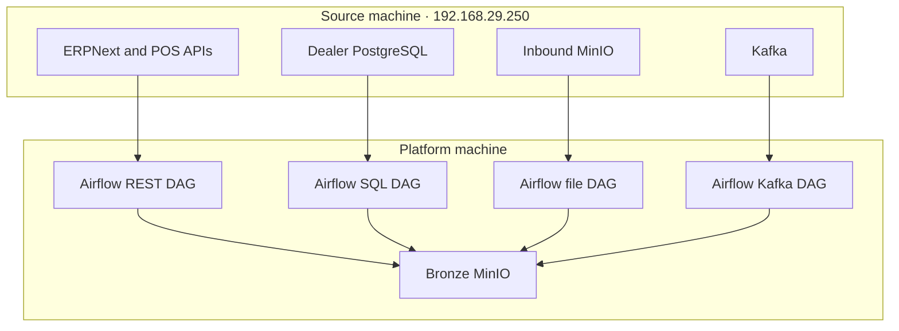

# OTC Bronze ingestion on two machines

The existing source cluster stays on **192.168.29.250**. Run Airflow and a separate MinIO instance on the **platform machine**. Bronze data and Airflow metadata persist in Docker volumes on the platform machine.



| Source port on 192.168.29.250 | Service | Airflow DAG |
|---|---|---|
| 28080 | ERPNext REST API | `otc_bronze_rest` |
| 28000 | Parent Commerce POS API | `otc_bronze_rest` |
| 25432 | Dealer PostgreSQL using `dealer_reader` | `otc_bronze_sql` |
| 29000 | Inbound MinIO using bucket `otc-inbound` | `otc_bronze_files` |
| 29092 | Kafka using `parent.orders.v1` | `otc_bronze_kafka` |

## 1. On the source machine

Extract the folder and run its gateway script from **PowerShell as Administrator** using the actual LAN IP of the platform machine.

```powershell
$PlatformIp = Read-Host 'Enter the platform machine LAN IP'
.\ingestion-airflow\expose-sources.ps1 -PlatformIp $PlatformIp
```

The script scopes a Windows inbound rule to that IP, adds Kafka's external advertised listener at `192.168.29.250:29092`, and binds the five forwards to the source LAN address. The in-cluster Commerce outbox continues to use `kafka:9092`. The listener change restarts the Kafka pod and reuses the existing Kafka volume. If you reapply the original Kafka manifest, rerun the gateway to restore the external listener.

Keep the gateway window open. If a source pod restarts and a forward ends, rerun the script. Use these plaintext listeners only on the trusted lab LAN. The forwards use separate ports from the existing localhost seed forwards.

## 2. On the platform machine

Install Docker with Compose v2, extract the bundle, and create `platform.env` from the sample. Set the following fields locally.

| Settings | Where to get them |
|---|---|
| `ERP_KEY`, `ERP_SECRET`, `ERP_COMPANY` | Existing ERP seed configuration. Use a read-capable ERP API user. |
| `DEALER_PASSWORD` | `DEALER_PASSWORD` in the source cluster's `source-credentials` Secret. |
| `SOURCE_S3_ACCESS_KEY`, `SOURCE_S3_SECRET_KEY` | Credentials for reading the source `otc-inbound` bucket. The existing MinIO credentials work for the local demo. |
| `BRONZE_S3_ACCESS_KEY`, `BRONZE_S3_SECRET_KEY` | Choose separate credentials for the new platform MinIO. Use a password of at least eight characters. |

Use single quotes for dotenv values containing literal dollar signs. Keep `platform.env` off version control and out of shared logs.

From the `ingestion-airflow` directory on the platform machine, run:

```powershell
Copy-Item .\platform.env.example .\platform.env
# Fill in platform.env before running the deployment.
.\deploy.ps1
```

On Linux, copy and edit `platform.env`, then run:

```bash
docker compose --env-file platform.env up --build --detach --wait --wait-timeout 300
docker compose --env-file platform.env exec -T airflow python /opt/otc/dags/bronze_ingest.py
```

The preflight checks ERPNext authentication, the POS API, the dealer read-only connection, Kafka's advertised endpoint, and both MinIO services from the Airflow container. It also creates the destination bucket `otc-bronze`. The Bronze image uses the same build-from-source approach as the existing source MinIO, so allow extra time on the first build.

## 3. Trigger and verify

Open [Airflow](http://127.0.0.1:18081) on the platform machine. Read the generated login with the command below and keep it private. Wait for the four DAGs to register, then unpause and trigger each one from the UI.

```powershell
docker compose --env-file platform.env exec -T airflow cat /opt/airflow/airflow-passwords.json
docker compose --env-file platform.env exec -T airflow airflow dags list-import-errors
docker compose --env-file platform.env exec -T airflow airflow dags list
foreach ($Dag in @('otc_bronze_rest', 'otc_bronze_sql', 'otc_bronze_files', 'otc_bronze_kafka')) {
    docker compose --env-file platform.env exec -T airflow airflow dags unpause $Dag
    if ($LASTEXITCODE -ne 0) { throw "Could not unpause $Dag" }
    docker compose --env-file platform.env exec -T airflow airflow dags trigger $Dag
    if ($LASTEXITCODE -ne 0) { throw "Could not trigger $Dag" }
}
```

Open the [platform MinIO console](http://127.0.0.1:19001) using the Bronze credentials and check the bucket.

- **REST:** ERPNext JSONL snapshots and parent POS receipt `P-POS1`.
- **SQL:** Five dealer customers, five products, warehouse `D-WH1`, and order `D-S1`.
- **Files:** Dealer exports, both Finance feeds, and mapping and policy files. Each copy preserves original bytes and verifies listed checksums.
- **Kafka:** Acceptance `P-E1` under `kafka/parent.orders.v1/generation=v1/`. A prior intentional replay produces two offsets for the same logical event. The consumer commits offsets after Bronze writes.

REST and SQL use full snapshots at seed scale. Kafka drains up to 500 deliveries in a bounded Airflow run. If the source Kafka topic is deleted and recreated, change `KAFKA_SOURCE_GENERATION` on the platform to prevent reused offsets from colliding with earlier Bronze data. Airflow starts with manual triggers.
