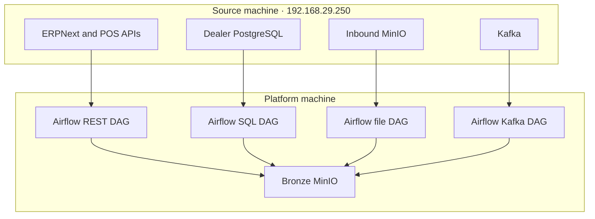
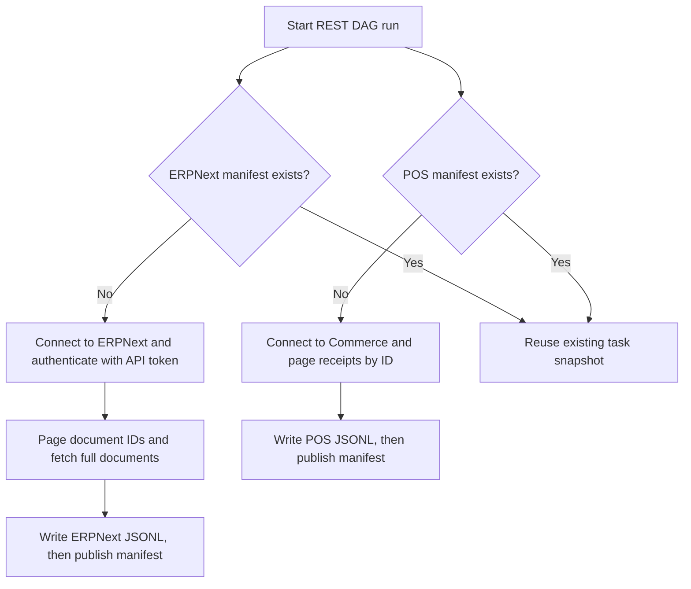
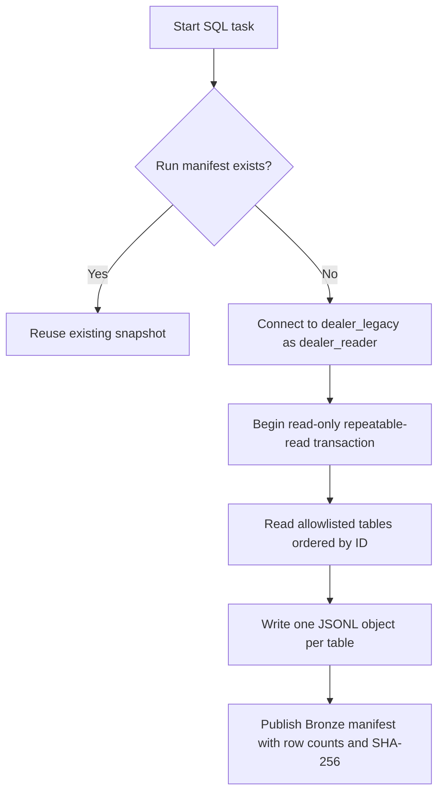
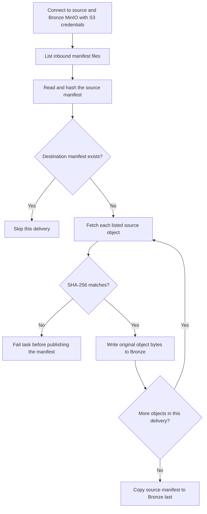
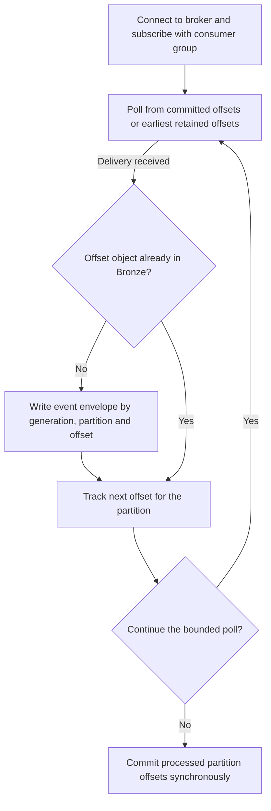

# OTC Bronze ingestion on two machines

[Project overview](../README.md) · [Source setup and seeding](../source-setup/README.md)

The existing source cluster stays on **192.168.29.250**. Run Airflow and a separate MinIO instance on the **platform machine**. Bronze data and Airflow metadata persist in Docker volumes on the platform machine.



| Source port on 192.168.29.250 | Service | Airflow DAG |
|---|---|---|
| 28080 | ERPNext REST API | `otc_bronze_rest` |
| 28000 | Parent Commerce POS API | `otc_bronze_rest` |
| 25432 | Dealer PostgreSQL using `dealer_reader` | `otc_bronze_sql` |
| 29000 | Inbound MinIO using bucket `otc-inbound` | `otc_bronze_files` |
| 29092 | Kafka using `parent.orders.v1` | `otc_bronze_kafka` |

## DAG execution and Bronze contracts

Airflow discovers four Python TaskFlow DAGs in [`dags/otc_ingestion.py`](dags/otc_ingestion.py). Source readers and MinIO writers live in [`dags/bronze_ingest.py`](dags/bronze_ingest.py). All four use manual triggering (`schedule=None`), `catchup=False`, one active run per DAG, and one task retry after 30 seconds. In Airflow, open a DAG’s **Graph** to see task dependencies. Open a task instance’s **Logs** to inspect what it reported writing. Use the Bronze objects and manifests to verify the data.

| DAG | Task IDs | Extraction model | Checkpoint or publication marker |
|---|---|---|---|
| `otc_bronze_rest` | `erpnext`, `parent_pos` | Full snapshots over paginated HTTP GET requests | Bronze manifest per task source and Airflow `run_id` |
| `otc_bronze_sql` | `dealer_sql` | Full PostgreSQL snapshot in a read-only, repeatable-read transaction | Bronze manifest per Airflow `run_id` |
| `otc_bronze_files` | `inbound_files` | Manifest-driven object copy | Destination manifest keyed by source path and manifest SHA-256 |
| `otc_bronze_kafka` | `kafka_orders` | Bounded Kafka consumer-group poll | Kafka-committed next offset per partition and offset-keyed Bronze objects |

### REST — `otc_bronze_rest`



- **`erpnext`** authenticates with the Frappe API token. It fetches the configured Company directly and lists other DocTypes in ascending `name` order, using `name > last_name` with a requested page size of 100. It then fetches each full document by name, preserving child rows such as order items and payment references. Customer, Item, and UOM are site-wide on the demo site. Warehouse, Account, Sales Order, Stock Entry, Delivery Note, Sales Invoice, Payment Entry, and GL Entry are filtered by company. Sales Invoice includes the seeded credit notes. GL Entry supplies posted ledger lines.
- **`parent_pos`** calls the Commerce `GET /pos/receipts` endpoint with a receipt-ID cursor (`after`) and a page size of 100. It captures receipt records, including item lines and tender data. The two REST tasks have independent task instances and manifests.
- **Checkpoint behavior.** The pagination cursor lives in task memory and starts over on a fresh extract. Each new DAG run reads full snapshots. A retry checks for that task’s published manifest and skips extraction if it exists. The individual HTTP requests do not share a point-in-time transaction.

### PostgreSQL — `otc_bronze_sql`



- **`dealer_sql`** connects to `dealer_legacy` as `dealer_reader` through Psycopg. It reads the allowlisted `public` tables `customers`, `products`, `warehouses`, `accounts`, `sales_orders`, `order_lines`, `shipments`, and `returns`. Each query orders rows by `id`. PostgreSQL repeatable-read isolation gives the table reads a consistent source snapshot within the transaction.
- **Checkpoint behavior.** Each new DAG run rescans the tables. The `id` determines row order and serves no cross-run watermark function. The connector does not read PostgreSQL WAL or use CDC. A retry skips extraction once its run manifest exists.

### Shared snapshot format for REST and SQL

Each task writes one UTF-8 JSONL object per collection to `s3://otc-bronze/batch/<source>/<encoded-run-id>/<encoded-collection>-<sha256>.jsonl`. The source is `erpnext`, `parent-pos`, or `dealer-sql`. The task writes `manifest.json` last as the publication marker. It records the source, Airflow run ID, start and publication timestamps, and each collection’s object key, row count, and SHA-256. A failed attempt can leave payload objects behind. Consume the files referenced by a published manifest.

### Inbound files — `otc_bronze_files`



- **`inbound_files`** uses the S3 API to paginate object listings in `otc-inbound` under `parent/finance/`, `dealer/finance/`, `dealer/exports/`, and `seed-v1/`. It discovers deliveries by `manifest.json`. These feeds include Finance files, dealer exports, and mapping and policy inputs.
- **Integrity and publication.** The task reads each listed source object, verifies its SHA-256, and preserves its original bytes under `s3://otc-bronze/files/otc-inbound/<source-prefix>/<manifest-sha256>/objects/<original-key>`. It copies the original manifest into that delivery directory after every expected file passes. A checksum mismatch, unreadable object, or required prefix without a manifest fails the task. Copying validates checksums. Any manifest row counts travel through unchanged.
- **Checkpoint behavior.** The source prefix plus SHA-256 of the raw manifest identifies a delivery. An existing destination manifest skips the copy. A new or changed manifest creates a new delivery version. Records repeated across different deliveries remain available in Bronze.

### Kafka — `otc_bronze_kafka`



- **`kafka_orders`** subscribes to `parent.orders.v1` using the consumer group `otc-bronze-airflow-<generation>`. It polls up to 500 deliveries within a 45-second polling window and can exit earlier when it reaches all partition ends. With no usable committed offset, it starts at the earliest retained offset.
- **Object identity and payload.** It writes one JSON envelope to `s3://otc-bronze/kafka/parent.orders.v1/generation=<generation>/partition=<partition>/offset=<offset>.json`. The envelope carries the topic, generation, partition, offset, Kafka timestamp metadata, ingestion time, and Base64-encoded key, value, and header values. Each object represents one Kafka delivery.
- **Checkpoint behavior.** Auto-commit is disabled. After all deliveries in the batch are written or confirmed at their destination keys, the consumer synchronously commits the next offset for each processed partition. A failure between object write and offset commit can redeliver a message. The offset-keyed existence check skips a repeated write. Two deliveries of the same business event at different offsets remain separate. A successful bounded run can leave lag for the next run.

### Rerun and troubleshooting checks

| Condition | Expected behavior or first check |
|---|---|
| No source changes between manual runs | REST and SQL publish new run manifests. Compare per-collection row counts and SHA-256 values for stable payloads. Files publish zero new manifests. Kafka preserves zero new deliveries if the previous run caught up. |
| New or updated source records | REST and SQL include them in the next full snapshot. Files require a new or changed upstream manifest. Kafka requires a newly published event on the topic. |
| REST task fails or counts drift | Check HTTP status, credentials, company scope, cursor progression, and source changes during pagination. |
| SQL task fails | Check the source gateway, `dealer_reader` grants, and PostgreSQL connectivity from the Airflow container. |
| File task fails | Check the incoming manifest, listed keys, bucket access, and source object checksums. Confirm the exporter published its manifest after its payloads. |
| Kafka task fails or reports fewer deliveries than expected | Check broker advertised listeners, topic metadata, consumer-group offsets, and lag. Trigger another run if the previous one reached the polling or message limit. |


## 1. On the source machine

From the repository root on the source machine, run the gateway script in **PowerShell as Administrator** using the actual LAN IP of the platform machine. If you downloaded the ingestion folder separately, run the command from its parent directory.

```powershell
$PlatformIp = Read-Host 'Enter the platform machine LAN IP'
.\ingestion-airflow\expose-sources.ps1 -PlatformIp $PlatformIp
```

The script scopes a Windows inbound rule to that IP, adds Kafka's external advertised listener at `192.168.29.250:29092`, and binds the five forwards to the source LAN address. The in-cluster Commerce outbox continues to use `kafka:9092`. The listener change restarts the Kafka pod and reuses the existing Kafka volume. If you reapply the original Kafka manifest, rerun the gateway to restore the external listener.

Keep the gateway window open. If a source pod restarts and a forward ends, rerun the script. Use these plaintext listeners only on the trusted lab LAN. The forwards use separate ports from the existing localhost seed forwards.

## 2. On the platform machine

Install Docker with Compose v2, extract the bundle, and create `platform.env` from the sample. Set the following fields locally.

| Settings | Where to get them |
|---|---|
| `ERP_KEY`, `ERP_SECRET`, `ERP_COMPANY` | Existing ERP seed configuration. Use a read-capable ERP API user. |
| `DEALER_PASSWORD` | `DEALER_PASSWORD` in the source cluster's `source-credentials` Secret. |
| `SOURCE_S3_ACCESS_KEY`, `SOURCE_S3_SECRET_KEY` | Credentials for reading the source `otc-inbound` bucket. The existing MinIO credentials work for the local demo. |
| `BRONZE_S3_ACCESS_KEY`, `BRONZE_S3_SECRET_KEY` | Choose separate credentials for the new platform MinIO. Use a password of at least eight characters. |

Use single quotes for dotenv values containing literal dollar signs. Keep `platform.env` off version control and out of shared logs.

From the `ingestion-airflow` directory on the platform machine, run:

```powershell
Copy-Item .\platform.env.example .\platform.env
# Fill in platform.env before running the deployment.
.\deploy.ps1
```

On Linux, copy and edit `platform.env`, then run:

```bash
docker compose --env-file platform.env up --build --detach --wait --wait-timeout 300
docker compose --env-file platform.env exec -T airflow python /opt/otc/dags/bronze_ingest.py
```

The preflight checks ERPNext authentication, the POS API, the dealer read-only connection, Kafka's advertised endpoint, and both MinIO services from the Airflow container. It also creates the destination bucket `otc-bronze`. The Bronze image uses the same build-from-source approach as the existing source MinIO, so allow extra time on the first build.

## 3. Trigger and verify

Open [Airflow](http://127.0.0.1:18081) on the platform machine. Read the generated login with the command below and keep it private. Wait for the four DAGs to register, then unpause and trigger each one from the UI.

```powershell
docker compose --env-file platform.env exec -T airflow cat /opt/airflow/airflow-passwords.json
docker compose --env-file platform.env exec -T airflow airflow dags list-import-errors
docker compose --env-file platform.env exec -T airflow airflow dags list
foreach ($Dag in @('otc_bronze_rest', 'otc_bronze_sql', 'otc_bronze_files', 'otc_bronze_kafka')) {
    docker compose --env-file platform.env exec -T airflow airflow dags unpause $Dag
    if ($LASTEXITCODE -ne 0) { throw "Could not unpause $Dag" }
    docker compose --env-file platform.env exec -T airflow airflow dags trigger $Dag
    if ($LASTEXITCODE -ne 0) { throw "Could not trigger $Dag" }
}
```

Open the [platform MinIO console](http://127.0.0.1:19001) using the Bronze credentials and check the bucket.

- **REST:** ERPNext JSONL snapshots and parent POS receipt `P-POS1`.
- **SQL:** Five dealer customers, five products, warehouse `D-WH1`, and order `D-S1`.
- **Files:** Dealer exports, both Finance feeds, and mapping and policy files. Each copy preserves original bytes and verifies listed checksums.
- **Kafka:** Acceptance `P-E1` under `kafka/parent.orders.v1/generation=v1/`. A prior intentional replay produces two offsets for the same logical event. The consumer commits offsets after Bronze writes.

If the source Kafka topic is deleted and recreated, change `KAFKA_SOURCE_GENERATION` on the platform before the next run. That creates a fresh consumer group and Bronze key prefix, so reused offsets do not collide with earlier deliveries.
