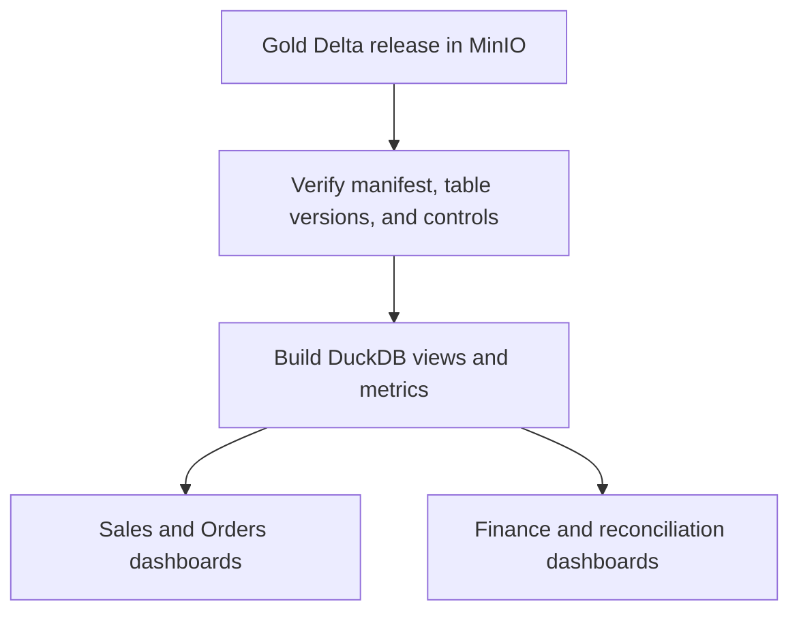

# OTC semantic layer and dashboards

DuckDB serves the business definitions shared by Sales, Orders, Finance, and Revenue Reconciliation. A build pins one published Gold Delta release, verifies the selected tables, then creates a local DuckDB database containing the data and SQL views. Streamlit reads that database. The same views and metric macro are available to DuckDB SQL clients.



## 1. Publish Gold

On the platform machine, publish from Gold notebook `14_gold_validate_publish.ipynb` with `PUBLISH_TARGET = "minio"`, or use the Gold CLI with `--publish`. Copy the exact manifest URI printed by Gold. The semantic build expects the updated `gold/` package with `gold_delta.py` alongside this `semantic/` folder.

By default the build uses the local MinIO S3 API at `http://127.0.0.1:19000` and the development credentials in `ingestion-airflow/platform.env`. To use another endpoint or scoped credentials, set `GOLD_S3_ENDPOINT`, `GOLD_S3_ACCESS_KEY`, and `GOLD_S3_SECRET_KEY` in the build process environment. The MinIO identity needs read access to the release and list access to its Delta table prefixes. Load secrets through your existing local secret mechanism.

## 2. Build and launch on Windows

Extract the bundle into the project root and run these commands from that root. Replace the manifest URI with the one Gold printed.

```powershell
python -m venv .\semantic\.venv
$Python = '.\semantic\.venv\Scripts\python.exe'
& $Python -m pip install -r .\semantic\requirements.txt
if ($LASTEXITCODE -ne 0) { throw 'Semantic dependencies failed to install.' }

$GoldManifest = 's3://otc-gold/releases/<actual-gold-release-id>/manifest.json'
& $Python .\semantic\build.py --manifest $GoldManifest
if ($LASTEXITCODE -ne 0) { throw 'Semantic build failed.' }

& $Python -m streamlit run .\semantic\dashboard.py --server.address 127.0.0.1 --server.port 8501
```

Open [the dashboard](http://127.0.0.1:8501). The sidebar shows the Gold cutoff and the Gold and Silver release IDs.

## 3. Read the executive dashboards

| Page | Executive view |
|---|---|
| Sales | Booking and net billing KPIs, period trend, and contribution by legal entity. |
| Orders | Booking volume, shipment-link coverage, and a separate storefront activity trend. |
| Customer 360 | Observed billing, unidentified customer billing, and a top-12 customer ranking. |
| AR Aging | Open and past-due balances, age buckets, and balance coverage. |
| Collections | Gross invoices and posted cash by due month. |
| P&L vs Budget | Comparable plan, actual, and variance for the selected scenario, version, and scope type. Plan coverage is charted when comparable actuals are missing. |
| Revenue Reconciliation | Matched documents, known differences, and unlinked ledger lines. The optional exception drill-down shows up to 25 billing documents and 25 ledger lines. |

Monetary views use one currency at a time. DuckDB filters and aggregates before sending chart data to Streamlit. Sales and order trends automatically use coarser periods for longer date selections. Collections and budget charts show up to 12 monthly groups. The default views contain charts and KPIs. The reconciliation exception toggle is the only record-level table.

To upgrade an existing installation, replace the files and restart Streamlit. An existing semantic DuckDB file works with this dashboard version.

## 4. Business definitions and grain

| Business app | DuckDB interface | Grain and rules |
|---|---|---|
| Sales | `sem_sales_daily`, `sales_kpis(...)` | One row per day, legal entity, and currency. Booked amount follows booking date. Net billed amount follows invoice and credit-note posting dates. Gross margin remains blank where Gold lacks coverage. |
| Orders and fulfillment | `sem_order_lines` | One row per eligible order line through the release cutoff. Distinct booked orders use the source-scoped order ID. Shipment records are rolled up to order-line grain before joining, so split shipments do not multiply booked amounts. An order with a linked shipment may still be partially fulfilled. |
| Storefront activity | `sem_orders_5m` | One row per five-minute UTC window and channel. Accepted orders are distinct within that window and channel. A sum across windows is a count of order appearances. |
| Customer 360 | `sem_customer_360` | One row per conformed customer, currency, and cutoff. Unresolved customer rows remain visible. Lifetime billing and 120-day inactivity are available only when history coverage is declared. |
| AR Aging | `sem_ar_aging` | One open-invoice record per legal entity and cutoff. Retains Gold's aging bucket, balance basis, and coverage status. |
| Collections | `sem_collections_monthly` | One row per invoice due month, legal entity, currency, and cutoff. Cash uses payment posting date. Average days to pay and collection rate remain blank pending timing and coverage rules. |
| P&L vs Budget | `sem_pnl_vs_budget` | One row per legal entity, period, scenario, budget version, planning scope, currency, and cutoff. Variance appears only where Gold establishes comparable actuals. |
| Revenue Reconciliation | `sem_revenue_reconciliation`, `sem_revenue_unlinked_postings` | One billing document per cutoff, with a separate view at GL posting-line grain for unlinked revenue. Difference is signed billing less mapped GL revenue when both are covered. |

Use the SQL layer directly for ad hoc queries. Read the release cutoff before choosing a business date range.

```sql
SELECT * FROM semantic_release;

SELECT *
FROM sales_kpis(DATE '2026-11-01', DATE '2026-11-30', NULL, 'INR');

SELECT legal_entity_id, currency, aging_bucket, balance_basis, coverage_status,
       sum(open_amount) AS open_ar
FROM sem_ar_aging
GROUP BY ALL;
```

The initial Sales screen uses a single reporting currency. The other pages preserve currency on every monetary row. A blank value in a published measure represents unavailable coverage.

## 5. Refresh after the next Gold release

Stop Streamlit with **Ctrl+C**, set `$GoldManifest` to the new release URI, and rerun the build and launch commands. The builder prepares a new database and replaces the serving file only after verification succeeds. Stopping the dashboard first releases Windows file handles. Keep `otc.duckdb` and other generated data files outside source control. Use `--database` and `OTC_SEMANTIC_DB` to build and serve a different local file.

The serving database contains selected Gold rows. Treat it as business data and use your filesystem's access controls. The app binds to loopback for local use.
