# Order-to-cash Silver entity relationship model

This logical model covers the parent ERPNext company, the acquired dealer, and the channel and finance feeds. Each entity box states **what one row represents** and shows the keys needed to understand its joins. Read the diagrams as views of the same model. Repeated boxes represent the same entity.

- **PK** is the logical row identifier shown in the diagram. Scoped native source keys are retained as alternate keys. Scope business documents by source installation and company, and site-wide ERPNext Customer and Item masters by source site. A child’s native ID is scoped by its parent where necessary.
- **FK** points to another modeled entity. Some FKs are shown in a different view. Each relationship shows how many rows at one end may relate to one at the other. Nullable source links remain visible as coverage exceptions.
- **Grain** is written in the box title after the entity name. These diagrams define logical keys and relationships. Precisions, physical indexes, and the history storage mechanism belong in the implementation design.

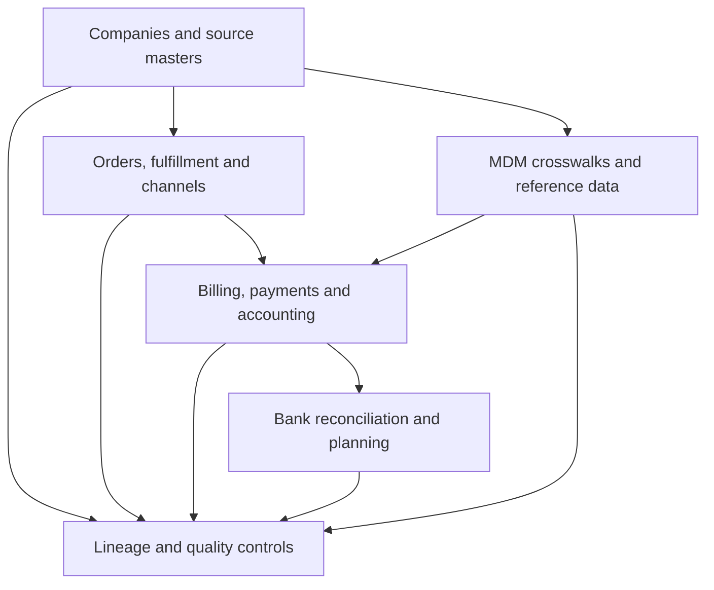

## 1. Order, customer and product

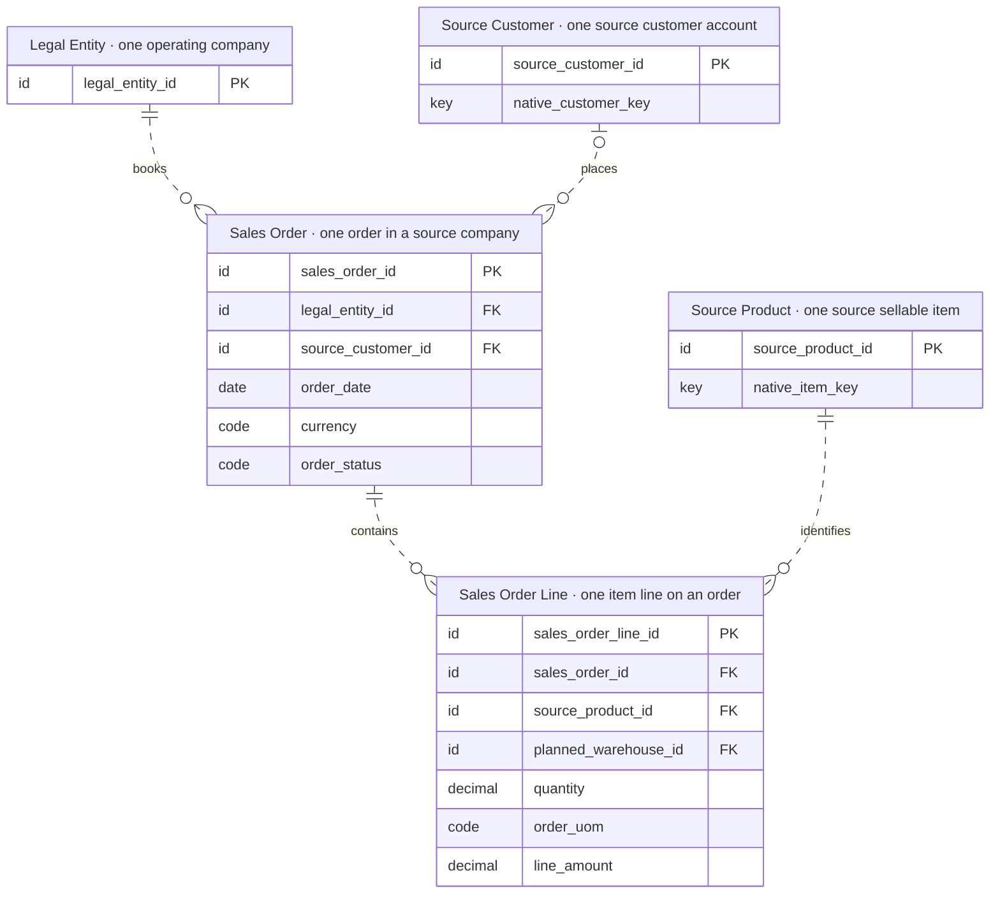

Customer identity resolves at the header. Product, ordered quantity, transaction unit and recorded amount belong to the line. A missing customer master may leave the resolved FK empty while retaining the source reference. A product FK is required on accepted merchandise lines. Draft or partially captured headers may have no lines. ERPNext fixture aliases such as P-S1 are lookup references.

## 2. Fulfillment and warehouses

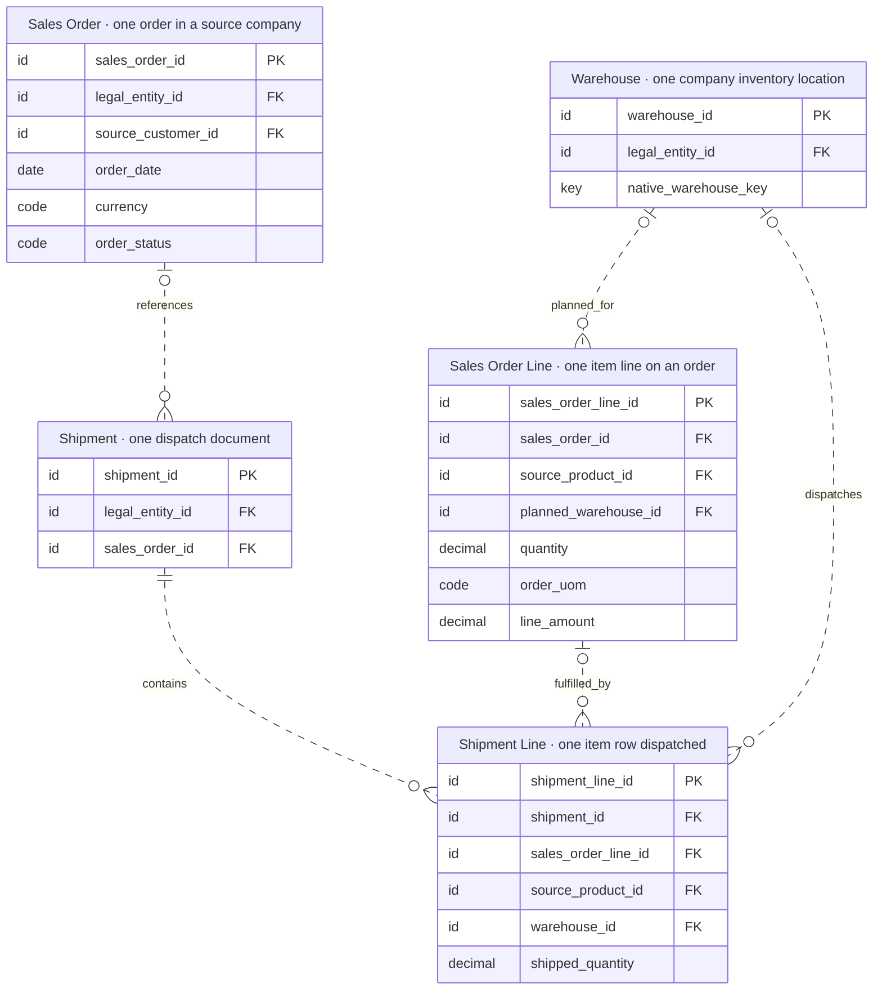

A parent order line can ship in several deliveries. ERPNext provides the line reference. The dealer currently supplies order and product and can link to a line when the candidate is unique and verified. For shipments spanning orders, the line references carry order provenance. The warehouse on the order line is planned. The warehouse on the shipment line is actual.

## 3. Physical returns and inventory movements

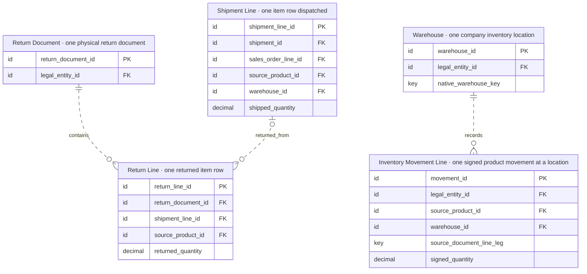

Return lines reference the original shipment line where evidenced. Each movement links to one source product and warehouse. Preserve the source movement reference for deduplication. A transfer yields two signed warehouse legs. A financial credit is modeled in Billing. A dealer return that lacks line evidence stays traceable through its source shipment reference.

## 4. Invoices and credits

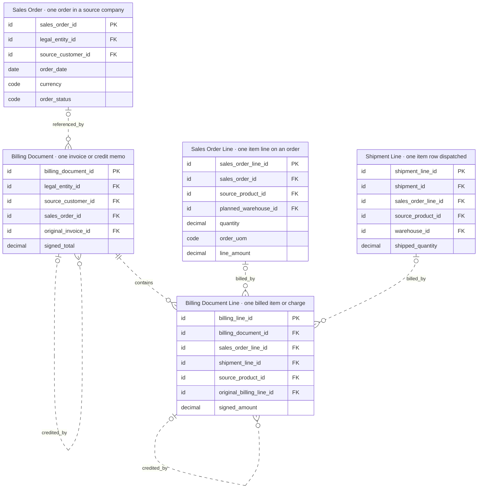

A header can have zero lines in Silver when the feed supplies document totals only, as with the dealer invoice CSV. The source order link and original invoice link are populated only where supported. ERPNext line references can trace an invoice through delivery back to the order. Credit quantity and postings do not establish a physical return.

## 5. Settlement and receivables

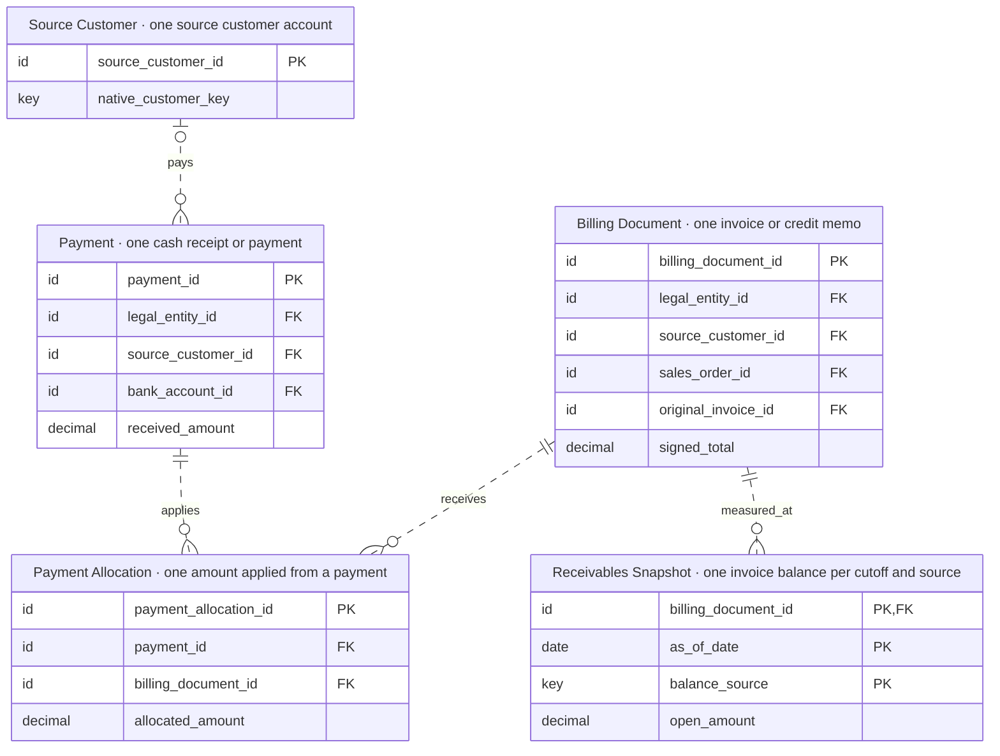

The payment-to-invoice many-to-many relationship is expressed through allocations. A payment can remain unallocated. Each AR balance keeps its own reporting cutoff and balance source. Preserve company and currency context when comparing source snapshots and calculated balances.

## 6. General ledger and voucher links

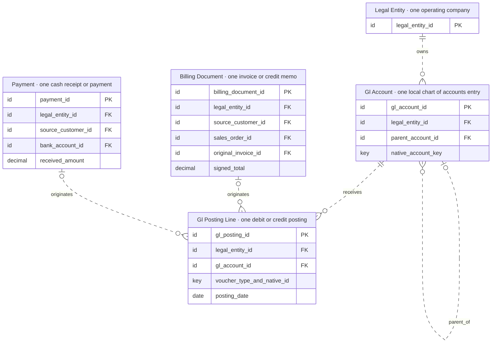

The billing and payment edges are conditional voucher references. Resolve using company, source, voucher type and ID. A posting may also come from another voucher type. The two displayed voucher links are mutually exclusive for a single posting. Account group nodes can sit in the hierarchy. Accepted postings reference posting accounts.

## 7. Storefront and point of sale

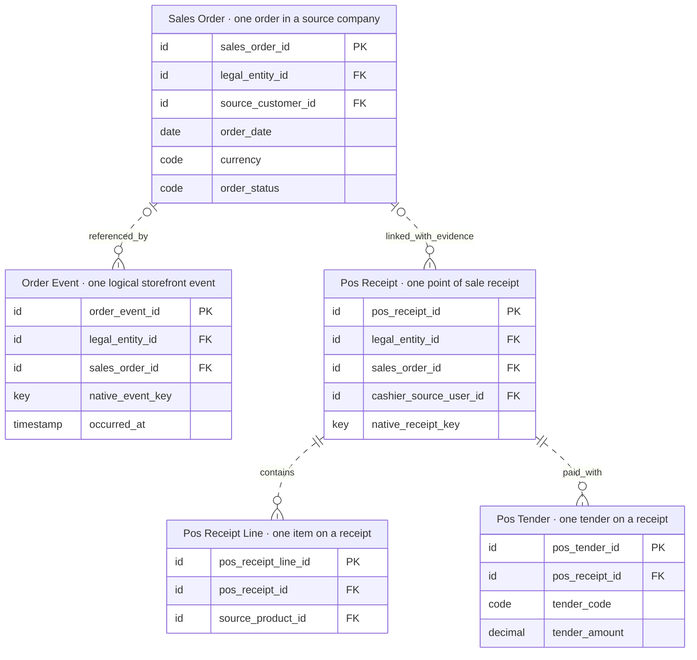

Channel relationships require an explicit source reference or approved bridge. Kafka partition and offset identify deliveries of an event. The scoped event ID identifies the logical event. POS item lines reference source products. A tender amount remains empty if only the tender code was captured.

## 8. Bank reconciliation

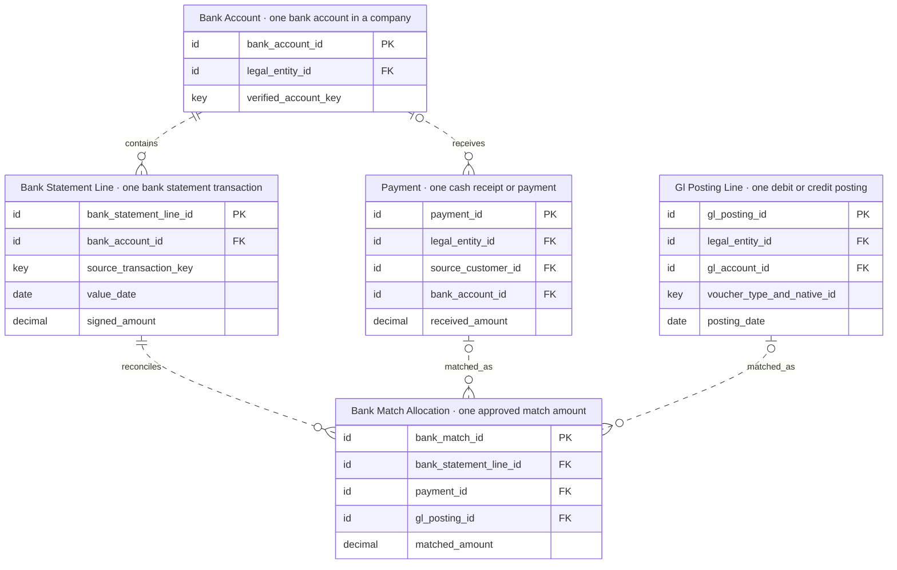

Each match allocation selects one payment or one GL posting as its target. Related payment and GL evidence can support a single match without double counting. A statement line can have no confirmed match or several split matches.

## 9. Pricing and planning

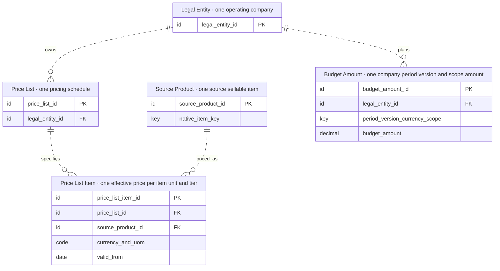

Price-list inputs are future coverage. Effective price scope includes unit, currency and quantity tier where applicable. The parent budget uses product category and the dealer budget uses local account. Each budget row carries its scope type and identifier. Validate the identifier against the applicable reference domain and compare actuals at that scope.

## 10. Shared reference values and actor identity

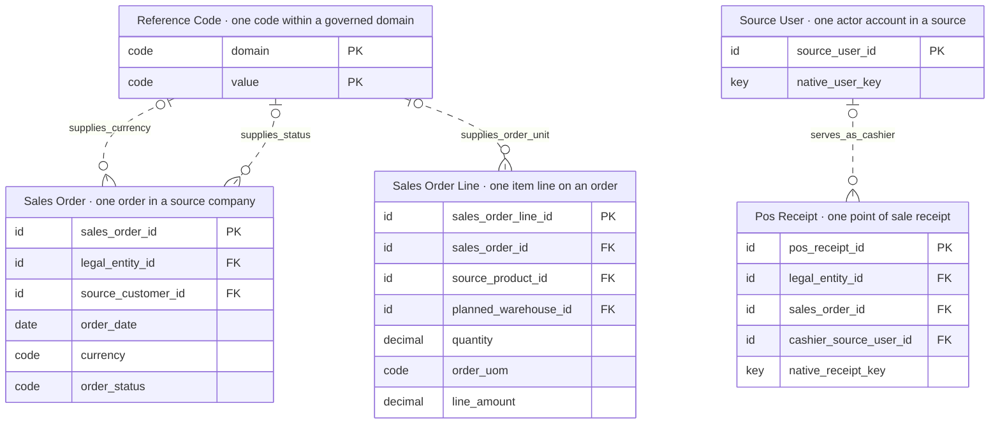

Reference code roles use a scoped domain and value, such as currency, order status, unit, channel or tender. The displayed code joins are examples of reusable roles across Silver. User capture is outside the current Bronze contract. The cashier FK shows a future relationship where a source supplies an actor ID.

## 11. MDM customer crosswalk

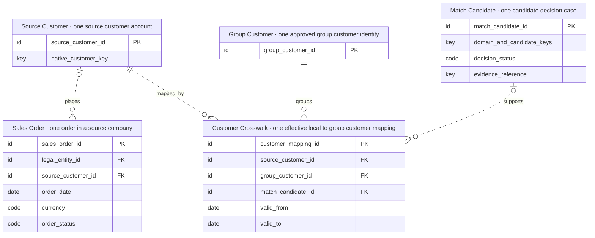

Multiple local customer accounts can map to one enterprise identity. Each local account can have at most one approved customer mapping effective at the lookup date. The order retains its local customer. An as-of join through the effective crosswalk supplies the group customer.

## 12. MDM product crosswalk and conversions

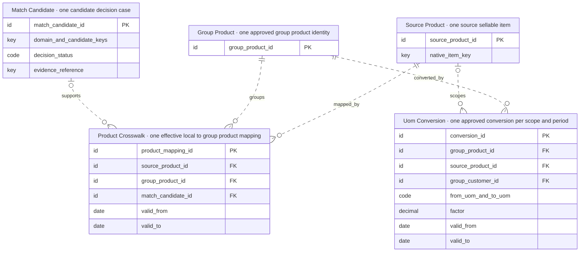

The order line joins to its source item as shown in view 1. Resolve group product via the crosswalk, then apply an approved conversion for that product and unit pair. A conversion may add source item, customer or agreement scope. One unambiguous approved rule must apply at the lookup date. Retain the recorded quantity, original unit and recorded amount alongside any conformed quantity.

## 13. MDM account classification

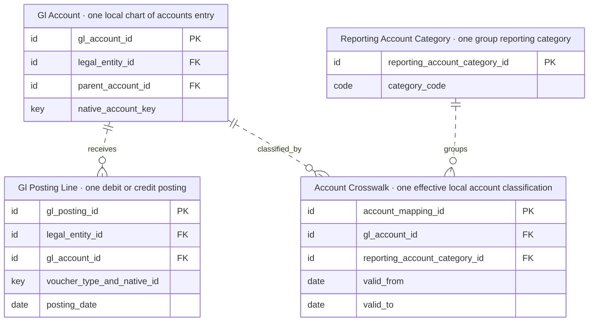

Finance approves effective account classifications, such as dealer 400-D to Sales Revenue. Each account has at most one approved reporting category per applicable date in this model. Warehouse identities remain company-scoped. Verified bank account identity and bank matching remain separate relationships.

## 14. Lineage, replay and exceptions

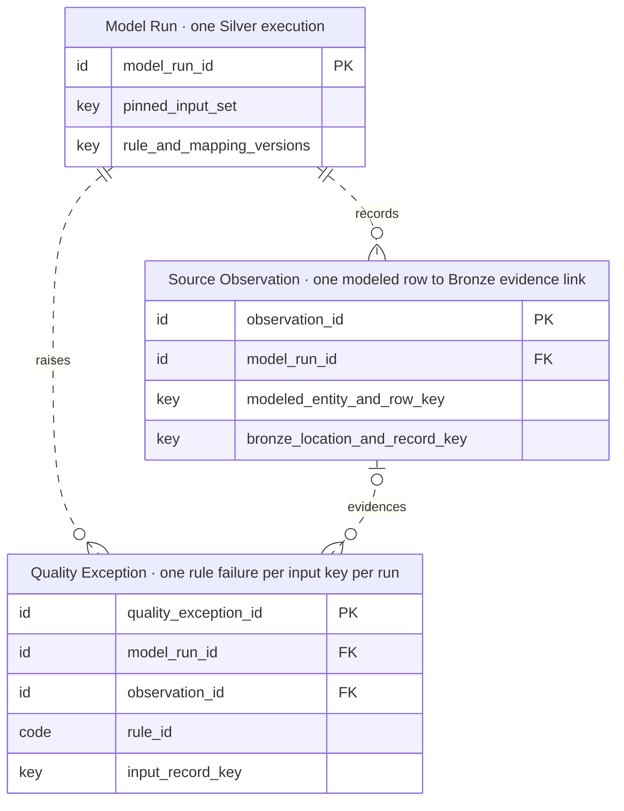

The lineage target is a typed reference to any modeled entity and row version. Multiple observations can support one business record. Record source manifest or Kafka delivery coordinates, business-effective time where available, observation time, and the rule and mapping versions used. An identical replay can add observation evidence without creating a new business version.

## Relationships that connect the views

| Foreign key holder | Referenced entity | Cardinality and rule |
|---|---|---|
| Shipment, Return Document, Billing Document, Payment, GL Posting Line, Inventory Movement Line, Bank Account, Order Event and POS Receipt | Legal Entity | Each record belongs to one company. Each company can own many records. |
| Billing Document | Source Customer | Each document has zero or one resolved source customer. A customer can have many documents. Keep the unresolved native reference when evidence is incomplete. |
| Shipment Line, Return Line, Inventory Movement Line and POS Receipt Line | Source Product | Each accepted merchandise or movement line identifies one source product. That product can appear on many lines. |
| Billing Document Line | Source Product | Zero or one product per line. A charge-only line may omit the product. |
| UOM Conversion | Group Customer | Zero or one scoped group customer per conversion. A customer may have many applicable rules across products, units and periods. |

## How MDM decisions become Silver joins

The ERDs above show the persistent relationships. This flow shows how decisions reach those tables while local transactions remain available for reconciliation.

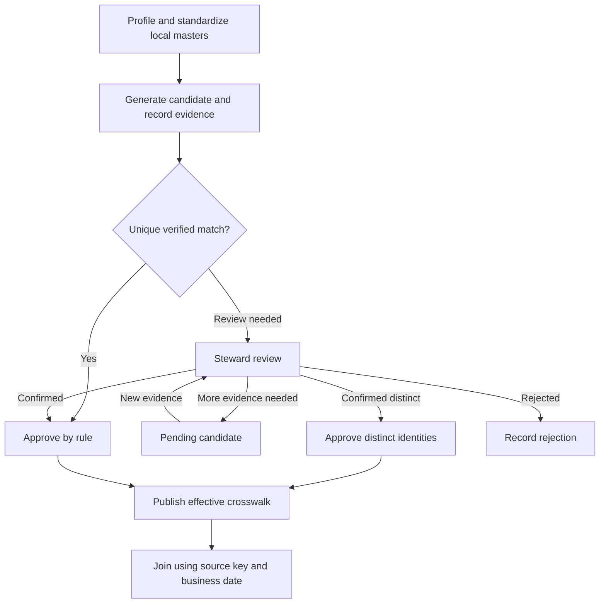

| Fixture | Crosswalk or rule | Expected result |
|---|---|---|
| Metro customer | Verified registration `DEMO-100`, with the parent fixture alias linked to its native Customer ID | Parent and dealer accounts roll up to one group customer. Apex stays local while evidence is pending. |
| Pump | Verified `ACME / RP100` | P-PUMP and D-PUMP roll up to one group product. The Metro slice still reconciles to two orders, 11 pumps and ₹140,000 in order value. |
| Seal pack | Product identity approval plus a separate approved conversion of one dealer pack to ten each | Source quantity stays one pack. Ten each is available for group quantity reporting once the conversion is effective. |
| Mapping correction | Publish a superseding decision with reason, evidence and effective period | Reproduce older outputs with the recorded version or restate approved outputs with the new version. Review validity overlaps before publishing. |

When reviewing a join, trace the scoped source key, verify the allowed cardinality, and compare record counts and amounts before and after the join. Check unresolved customer links, repeated product lines, split shipments, document-only dealer billing, replayed channel events, and overlapping mapping dates.
